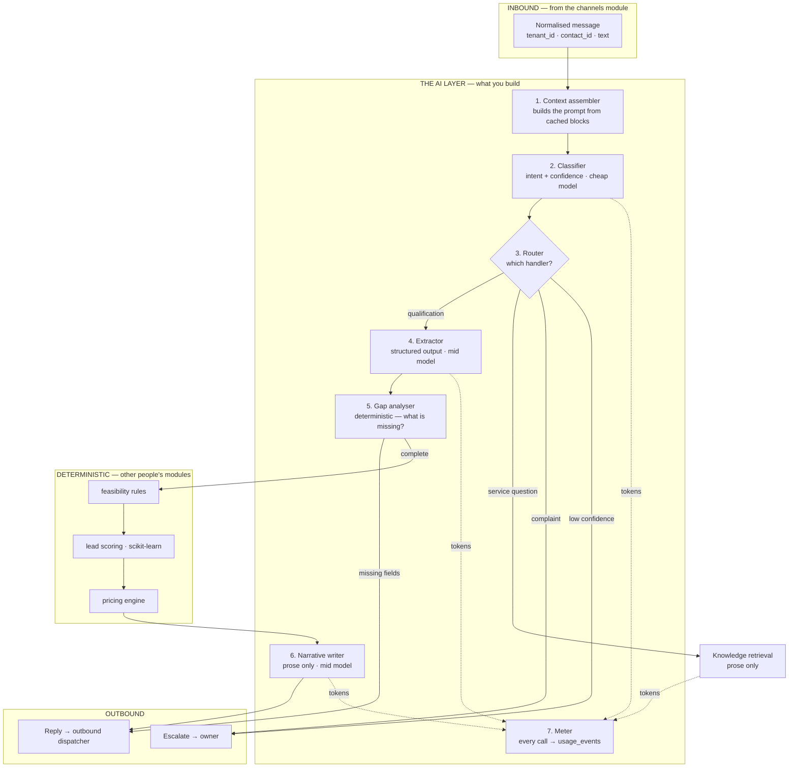
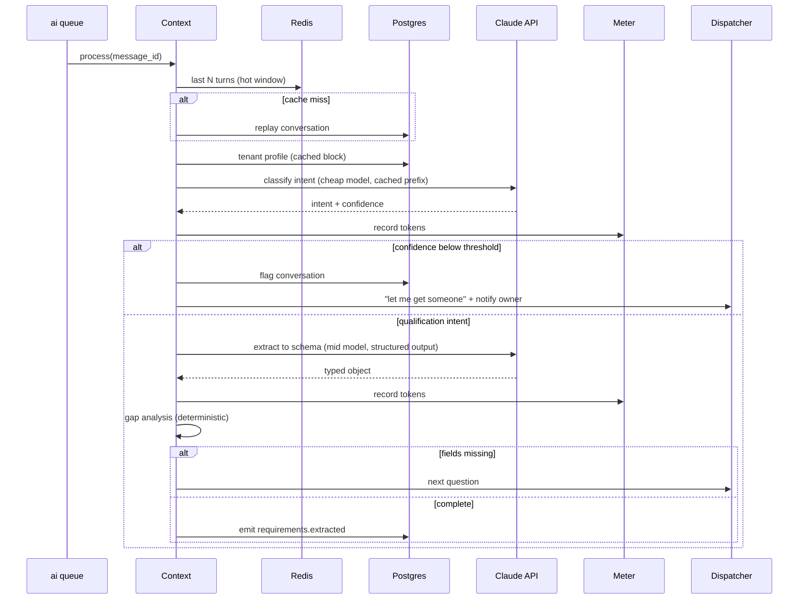
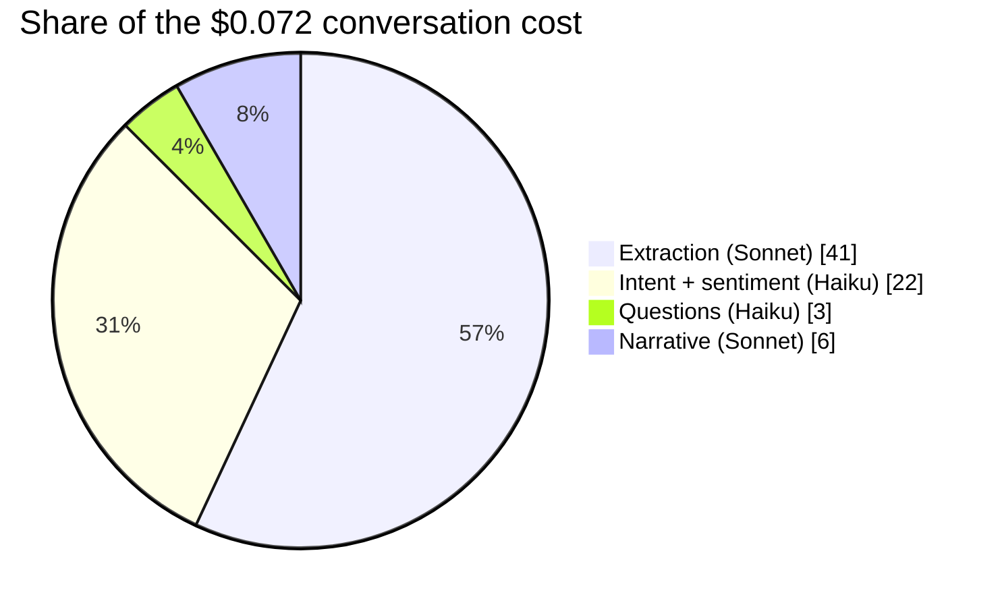
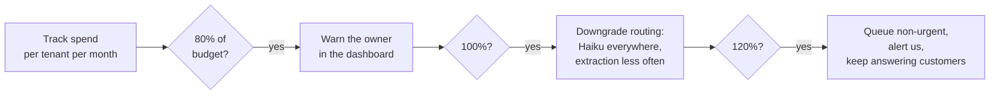
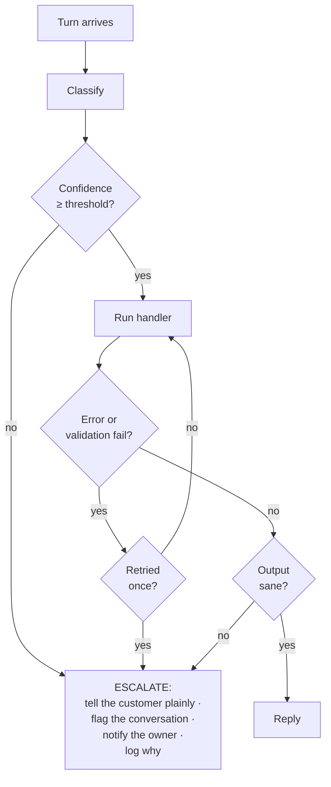

# The Agentic AI Layer — Design & Cost Guide

**For:** the two engineers building the AI layer.
**Assumes:** Python, comfort with LLM APIs. Assumes **no** prior knowledge of this project.
**Status:** design recommendation. Companion to [`SYSTEM_DESIGN.md`](SYSTEM_DESIGN.md)
(whole system) and [`STRATEGY_FINDINGS.md`](STRATEGY_FINDINGS.md) (the research
behind the constraints).

> **Read §1 and §2 before writing any code.** They contain the one rule that, if
> broken, makes the product legally dangerous and commercially indefensible.

---

## Contents

1. [What you are building](#1-what-you-are-building)
2. [The one rule](#2-the-one-rule)
3. [Layer architecture](#3-layer-architecture)
4. [The turn pipeline](#4-the-turn-pipeline)
5. [Task catalogue](#5-task-catalogue)
6. [Model routing and cost per task](#6-model-routing-and-cost-per-task)
7. [Prompt caching — the highest-leverage optimisation](#7-prompt-caching--the-highest-leverage-optimisation)
8. [Cost model: what a real conversation costs](#8-cost-model-what-a-real-conversation-costs)
9. [Non-LLM services and their costs](#9-non-llm-services-and-their-costs)
10. [Metering, budgets and quotas](#10-metering-budgets-and-quotas)
11. [Failure handling and escalation](#11-failure-handling-and-escalation)
12. [Multi-tenancy in the AI layer](#12-multi-tenancy-in-the-ai-layer)
13. [Compliance obligations that land on you](#13-compliance-obligations-that-land-on-you)
14. [Testing and evaluation](#14-testing-and-evaluation)
15. [Build order](#15-build-order)
16. [Open questions](#16-open-questions)

---

## 1. What you are building

A small business — say a cleaning company — connects their WhatsApp, Instagram
and Messenger accounts to our platform. Their customers message them as normal.
An AI agent answers, works out what the customer needs, checks whether the
business can actually do the job, and produces a priced quote that the **owner
approves from their phone** before it reaches the customer.

Your job is the middle: **the layer that turns messages into structured
decisions.**

You do **not** own pricing arithmetic, feasibility rules, or database writes —
those are deterministic modules built by others. You own understanding,
extraction, routing, narrative generation, and the cost of all of it.

### The five things the AI layer actually does

| # | Task | Output |
|---|---|---|
| 1 | Classify what the customer wants | An intent label + confidence |
| 2 | Pull structured details out of free text | JSON matching a per-vertical schema |
| 3 | Decide what is still missing and ask for it | The next question, or "complete" |
| 4 | Judge sentiment for routing only | A label, never an emotional profile |
| 5 | Write the covering narrative for a quote | Prose wrapped around numbers it did not compute |

Everything else in the product is deterministic Python.

---

## 2. The one rule

> **The model never produces a number that commits the business.**
>
> Deterministic code computes the price from structured data a human approved.
> The model writes the prose around it.

This is not a stylistic preference. It rests on four findings:

- **Whole-document extraction accuracy is 28–77%.** Field-level accuracy looks
  fine (83–96%), but a rate card is only useful if *all* of it arrived.
- **46.89% of LLM table-reading errors still produce a correct-looking answer.**
  The failure is **silent** — a wrong row returns a real price for the wrong
  service. You cannot catch it by reviewing outputs.
- **A quoted price binds the business.** Sweden caps overrun on an approximate
  price at 15% by statute; Denmark applies a ~15% norm; UK quotations bind on
  acceptance. The obvious-error escape hatch only covers absurd numbers —
  £1 for a boiler is escapable, £340 for a £480 job is not.
- **It has happened.** *Moffatt v Air Canada* (2024) forced an airline to honour
  a policy its chatbot invented, rejecting the "the chatbot is a separate agent"
  defence. A Toronto BMW dealership paid ~$27,000 in 2026 on an AI-generated
  price. A Chevrolet dealer was prompt-injected into "$1 Tahoe… no takesies
  backsies" and pulled its chatbot entirely.

⚠️ **Common misunderstanding:** the rule is often justified by pointing at AI
regulation. That justification is **wrong** — the relevant high-risk annex covers
pricing only for life and health insurance. The real exposure is ordinary
contract and consumer law, which is **larger**. Do not weaken the rule on the
grounds that "the AI Act doesn't apply here."

### What this means concretely

| Allowed | Never |
|---|---|
| Retrieval over service descriptions, policies, FAQs, opening hours | Retrieval that produces a price, rate, minimum or callout fee |
| Extracting a draft rate card during onboarding, for a human to confirm | Reading a price list at runtime to answer a customer |
| Writing "Based on a 3-bedroom deep clean, here's what we'd propose…" | Writing "That'll be £340" where £340 came from the model |
| Judging that a message is a complaint | Deciding the refund amount |

OWASP's line is worth pinning above your desk:

> *"The model generates text — it does not enforce policy."*

---

## 3. Layer architecture



### Boundaries you must respect

- **You receive normalised messages.** Channel-specific parsing already happened.
  One message shape regardless of WhatsApp, Instagram or Messenger.
- **You never write to another module's tables.** Emit events; consumers react.
- **You never call the LLM on the webhook path.** The webhook verifies, persists,
  enqueues and returns 200 in under 200ms. You run on the `ai` Celery queue.
- **Every call is metered before you return.** No exceptions, including failures.

---

## 4. The turn pipeline

What happens when one customer message arrives.



### Latency budget

A customer is waiting. Target **under 4 seconds** to first reply.

| Stage | Target |
|---|---|
| Queue pickup | < 100ms |
| Context assembly (Redis hit) | < 50ms |
| Intent classification | < 800ms |
| Extraction (when it runs) | < 2.5s |
| Dispatch | < 200ms |

⚠️ If extraction and classification both run on the same turn, you are at ~3.5s.
That is why classification uses the cheapest, fastest model and why extraction
does not run on every turn.

---

## 5. Task catalogue

Every distinct AI task, with what it costs and why it is sized that way.

### 5.1 Intent classification

**Runs:** every inbound turn. Highest volume task in the system.
**Input:** last ~3 turns + tenant intent list. **Output:** one label + confidence.

Labels: `new_enquiry` · `providing_details` · `question_about_service` ·
`complaint` · `chasing_status` · `cancellation` · `small_talk` · `unclear`

```python
class IntentResult(BaseModel):
    intent: Literal["new_enquiry", "providing_details", ...]
    confidence: float  # 0..1
    reasoning: str     # one line, for the audit log
```

**Model:** Haiku 4.5. **Why:** it is a bounded-label classification with a short
prompt. A frontier model adds nothing and costs 5× the input rate.

### 5.2 Requirement extraction

**Runs:** on `new_enquiry` and `providing_details` turns only — not every turn.
**Input:** the whole conversation + the vertical's JSON schema.
**Output:** a typed object; unknown fields left null.

This is the **quality-critical** task. A missed field means an extra question and
a longer conversation; a *wrong* field means a wrong quote.

**Model:** Sonnet 5 with structured outputs.
**Why not Haiku:** extraction over messy multi-turn text with nullable fields is
where cheap models silently guess. **Why not Opus:** measured quality difference
on bounded-schema extraction does not justify 2.5× the input rate — but
[verify this yourself](#14-testing-and-evaluation) against a real eval set
before locking it in.

⚠️ **Always use structured outputs** (`output_config.format`). Parse-and-retry
loops are a silent doubling of cost.

### 5.3 Gap analysis

**Deterministic. No LLM.** Compare the extracted object against the vertical's
required-field list. Return the highest-priority missing field.

Listed here because it is easy to hand to a model by accident. Don't — it is a
set difference, it must be reproducible, and it costs nothing.

### 5.4 Question generation

**Runs:** when a gap exists.
**Input:** the missing field + conversation tone. **Output:** one natural question.

**Model:** Haiku 4.5, or a template with light variation.
**Why:** "How many bedrooms?" does not need a frontier model. Start with
templates and only add a model call if the templates read robotically.

### 5.5 Sentiment classification

**Runs:** every inbound turn, alongside classification — **combine into one call.**
**Output:** `positive` | `neutral` | `negative` | `frustrated`.

**Model:** Haiku 4.5, merged into the classification call at no extra cost.

⚠️ **Naming matters legally.** This is *sentiment classification for routing and
escalation*, operating on message text only. It is **not** emotion recognition
and must never be described as inferring a person's emotional state. Emotion
recognition carries prohibitions in some contexts and disclosure duties in
others. Keep the label, the code comments and the docs consistent on this.

### 5.6 Knowledge retrieval (RAG)

**Runs:** on `question_about_service`.
**Scope:** service descriptions, policies, FAQs, opening hours, what's included,
guarantees. **Never** prices.

**Model:** Sonnet 5 over retrieved chunks.
**Requirements, not optional:**

- **Source attribution on every answer** — which document, which chunk.
- **Pre-retrieval tenant filtering at the index.** Post-filtering exposes other
  tenants' data *during* the search itself.
- **Tenant ID in every cache key.**

### 5.7 Quotation narrative

**Runs:** once per draft quote.
**Input:** the computed line items and total. **Output:** covering prose.

**Model:** Sonnet 5.
**Hard constraint:** the numbers arrive in the prompt as computed facts. The
model may restate them; it may never derive, adjust or estimate them. Validate
the output — if a number appears in the narrative that is not in the input,
reject and regenerate.

```python
# after generation
nums_in = extract_numbers(line_items)
nums_out = extract_numbers(narrative)
if not nums_out.issubset(nums_in):
    raise NarrativeNumberMismatch()   # regenerate, then escalate
```

### 5.8 Onboarding: rate-card extraction

**Runs:** once per tenant at setup, offline. Not on the conversation path.
**Input:** an uploaded price list. **Output:** a *draft* structured rate card.

**Model:** Opus 5 — quality matters far more than cost here, it runs once, and
the owner reviews the result.
**Non-negotiable:** the output is a **draft**. The owner confirms it before any
pricing runs. Flag contradicting rows rather than silently resolving them.

Budget ~10–15 minutes of owner review on a 40-line card. Promise that, not
"done in seconds."

---

## 6. Model routing and cost per task

### Current pricing

| Model | ID | Input $/MTok | Output $/MTok | Context |
|---|---|---|---|---|
| Claude Opus 5 | `claude-opus-5` | $5.00 | $25.00 | 1M |
| Claude Sonnet 5 | `claude-sonnet-5` | $2.00 | $10.00 | 1M |
| Claude Haiku 4.5 | `claude-haiku-4-5` | $1.00 | $5.00 | 200K |

⚠️ Pricing and model IDs change. Re-verify before you commit cost figures to a
pricing page. Cache reads are billed at a fraction of input rate — see §7.

### The routing table

| Task | Model | Frequency | Why this tier |
|---|---|---|---|
| Intent + sentiment (one call) | **Haiku 4.5** | Every turn | Bounded labels, short prompt. Frontier adds nothing |
| Requirement extraction | **Sonnet 5** | ~40% of turns | Quality-critical; cheap models guess at nullable fields |
| Question generation | **Haiku 4.5** / template | When a gap exists | Trivial generation |
| Knowledge retrieval | **Sonnet 5** | On service questions | Needs to follow retrieved context faithfully |
| Quotation narrative | **Sonnet 5** | Once per quote | Tone matters; numbers are given |
| Rate-card extraction | **Opus 5** | Once per tenant | Offline, human-reviewed, quality dominates |
| Feasibility, pricing, scoring, gap analysis | **No model** | — | Deterministic by rule |

### Effort settings

`output_config: {effort: ...}` trades thoroughness against tokens within one model.

| Task | Effort | Reason |
|---|---|---|
| Classification | `low` | Bounded labels; higher effort is waste |
| Extraction | `medium` | Measure `high` before adopting it |
| Narrative | `low` | Short prose from given facts |
| Rate-card extraction | `high` | Runs once, accuracy dominates |

⚠️ **Measure before raising a default.** Higher effort earns its cost on hard
problems, not on classification. And judge **cost per completed conversation**,
not per request — a cheaper call that causes an extra turn is not cheaper.

---

## 7. Prompt caching — the highest-leverage optimisation

The tenant's business profile is **large, static per tenant, and repeated on
every single call**. That makes it the highest-value cache in the system.

### How caching works, in one paragraph

Caching is a **prefix match**. Any byte change anywhere in the prefix invalidates
everything after it. Render order is `tools` → `system` → `messages`. So: stable
content first, volatile content last.

### Prompt layout

```
┌─────────────────────────────────────────┐
│ tools          (identical per vertical) │  ← cache
│ system         (frozen instructions)    │  ← cache breakpoint 1
│ tenant profile (services, areas, hours) │  ← cache breakpoint 2
│ vertical schema                         │  ← cache breakpoint 3
├─────────────────────────────────────────┤
│ conversation history                    │  ← volatile
│ this turn's message                     │  ← volatile
└─────────────────────────────────────────┘
```

Max 4 breakpoints per request. Minimum cacheable prefix is model-dependent
(roughly 512–4096 tokens) — shorter prefixes silently fail to cache.

### The silent invalidators

These will destroy your hit rate and produce no error:

| Invalidator | Fix |
|---|---|
| `datetime.now()` anywhere in the system prompt | Move to the last user message |
| Unsorted JSON serialisation of the profile | `json.dumps(..., sort_keys=True)` |
| Tool list order varying between calls | Sort tool definitions |
| Per-request IDs in the prefix | Move after the last breakpoint |
| Changing top-level `effort` mid-conversation | Invalidates the messages cache |

### Verify it is working

```python
resp = client.messages.create(...)
u = resp.usage
hit_rate = u.cache_read_input_tokens / max(1, u.input_tokens)
log.info("cache", extra={"tenant": tid, "hit_rate": hit_rate})
```

**If `cache_read_input_tokens` is zero across repeated requests, a silent
invalidator is at work.** Alert on a per-tenant hit rate below 50%.

---

## 8. Cost model: what a real conversation costs

### Assumptions

- A qualification conversation is **12 turns**.
- Tenant profile ≈ **2,000 tokens**, system prompt ≈ **800**, schema ≈ **400**.
  Cacheable prefix ≈ **3,200 tokens**.
- Conversation history grows to ~1,500 tokens by the end.
- Extraction runs on ~5 of the 12 turns.
- Narrative runs once.

### Without caching or routing (everything on one mid model)

| Item | Calls | Input tok | Output tok | Cost |
|---|---|---|---|---|
| Every turn, full prefix | 12 | ~56,000 | ~2,400 | $0.136 |

**≈ $0.14 per conversation.**

### With routing and caching

| Task | Model | Calls | Uncached in | Cached in | Out | Cost |
|---|---|---|---|---|---|---|
| Intent + sentiment | Haiku | 12 | ~9,000 | ~38,400 | 600 | $0.022 |
| Extraction | Sonnet | 5 | ~5,500 | ~16,000 | 1,500 | $0.041 |
| Questions | Haiku | 5 | ~1,200 | — | 250 | $0.003 |
| Narrative | Sonnet | 1 | ~900 | — | 400 | $0.006 |
| **Total** | | **23** | | | | **≈ $0.072** |

**≈ $0.07 per conversation — roughly half.** Cache reads are billed well below
the input rate, which is where most of the saving comes from.

### Per tenant, per month

| Scenario | Conversations | LLM cost |
|---|---|---|
| Quiet tenant | 50 | ~$3.60 |
| Typical tenant | 200 | ~$14.40 |
| Busy tenant | 500 | ~$36.00 |

Against a subscription in the **€49–99/month** band, a typical tenant spends
roughly **15–30% of revenue on LLM calls**. That is survivable but not
comfortable — and it is why metering is a v1 requirement rather than a v2 nicety.

⚠️ **The busy tenant is the danger.** At 500 conversations, LLM cost alone is
~36% of a €99 subscription before any other infrastructure. Flat pricing is only
safe with per-tenant budgets — see §10.

### Where the cost actually goes



Read as a share of the optimised total: extraction is **57%** of the bill,
intent and sentiment **31%**, and the two small tasks the remainder.

Extraction dominates. If you optimise one thing, optimise **how often extraction
runs** — not which model it uses. Running it only on turns that plausibly carry
new information is the single biggest lever after caching.

---

## 9. Non-LLM services and their costs

| Service | What for | Cost shape | Optimisation |
|---|---|---|---|
| **WhatsApp Cloud API** | Customer messaging | Per message since Jul 2025. Inbound replies inside the 24h service window have historically been free ⚠️ **verify — sources conflict on a possible change** | Keep the product inbound. Business-initiated templates are the expensive traffic |
| **Instagram / Messenger** | Customer messaging | Generally no per-message fee | — |
| **Telegram** | Owner notifications | Free | Use as the approval-notification fallback |
| **Postgres** | Everything | Instance-hour | `messages` is the only unbounded table — ~9M rows/yr at 200 tenants. Fine. Don't partition yet |
| **Redis** | Hot conversation window, rate limits | Instance-hour or per-command | Cache last N turns only, TTL ~24h |
| **S3** | Media, quotation PDFs | Storage + egress | Lifecycle-expire raw media after 90 days |
| **Embeddings** (if used for catalogue search) | Product search | Per token, one-off per item + per query | Embed on change, not on read. Cache query embeddings |
| **Sentry** | Errors | Per event | Sample aggressively in production |

⚠️ The WhatsApp service-window question is live and it hits unit economics
directly. **Verify against the provider's own policy before publishing any
pricing tier.** Earlier cost reasoning in this project assumed inbound is free.

---

## 10. Metering, budgets and quotas

### `usage_events` — write on every call, including failures

```python
@dataclass
class UsageEvent:
    tenant_id: UUID
    conversation_id: UUID | None
    task: str              # "intent" | "extraction" | "narrative" | ...
    model: str
    input_tokens: int
    cached_read_tokens: int
    output_tokens: int
    cost_usd: Decimal      # computed at write time, not later
    latency_ms: int
    success: bool
    created_at: datetime
```

**Compute `cost_usd` at write time.** Rates change; a historical row must reflect
what it actually cost, and back-computing from a rate table you have since edited
gives you the wrong number.

### The budget ladder



⚠️ **Never hard-stop a customer conversation.** A tenant over budget is a
commercial problem between us and them. Silently dropping their customer's
message makes it the *customer's* problem, which is how a tenant churns.
Degrade quality, alert loudly, keep answering.

### Alert thresholds worth having from day one

- Per-tenant cache hit rate below 50%
- Per-conversation cost above 3× median
- Any single call above $0.05
- Extraction running on more than 60% of turns (your gating logic has drifted)

---

## 11. Failure handling and escalation

**The agent's most valuable behaviour is admitting it cannot help.** A confident
wrong answer costs the tenant a customer; "let me get someone" costs nothing.



### Escalation triggers

| Trigger | Threshold |
|---|---|
| Low classification confidence | < 0.7 (tune against real traffic) |
| Extraction validation failure | After one retry |
| Narrative contains an unexpected number | Immediately, no retry |
| Customer asks the same thing twice | Second repeat |
| Sentiment negative *and* intent is complaint | Immediately |
| Any API error after retry | Immediately |

### What the customer sees

Plain and honest: *"I want to make sure I get this right — let me bring in a
colleague."* Never a stack trace, never silence, never a guess.

### API error handling

Catch a **chain**, not one broad class — retryable and non-retryable failures
need different treatment:

```python
try:
    resp = client.messages.create(...)
except anthropic.NotFoundError:        # non-retryable — config bug
    raise
except anthropic.RateLimitError:       # retryable — backoff
    raise Retry(after=e.retry_after)
except anthropic.APIStatusError as e:  # 4xx/5xx split
    if e.status_code >= 500: raise Retry()
    raise
except anthropic.APIConnectionError:   # retryable
    raise Retry()
```

---

## 12. Multi-tenancy in the AI layer

Every rule in the wider system applies here, plus three specific to you.

**1. Tenant ID in every cache key.** Prompt caches, embedding caches, retrieval
indexes. A cross-tenant cache hit is a data breach, not a bug.

**2. Pre-retrieval filtering, never post-retrieval.** Filtering *after* the
search means the search itself ran across other tenants' documents.

**3. No shared prompt state between tenants.** No module-level mutable caches
keyed on anything but `tenant_id`. State lives in Postgres or Redis, never in
worker memory — any worker must be able to pick up any turn of any conversation.

### Configuration is data, never code

A tenant's prompts, intent labels, extraction schema and disclosure text are
**rows**, not branches in your code. If you ever find yourself writing
`if tenant_id == ...`, stop — that is the fork that turns one product into two.

---

## 13. Compliance obligations that land on you

Three of the six platform compliance requirements are implemented inside the AI
layer. They are not optional and not someone else's job.

### 13.1 AI disclosure

The **first outbound message of every new conversation** must state the customer
is talking to an AI.

- Wording is per-tenant configurable but **not disableable**.
- **Repeat** it when a conversation resumes after a long gap, and when handing
  back from a human to the agent.
- On handoff **to** a human, say so — the transition must be visible.
- **Log it as an event.** "We disclosed" is a claim you must be able to evidence.

Enforceable since 2 August 2026, with penalties reaching €15m or 3% of worldwide
turnover.

### 13.2 No terminal automated rejection

If feasibility fails, the agent must **never** close the conversation itself.
Route to the owner, or produce a non-final outcome with a documented route to a
human. The original design had `not feasible → lead closed`; that path is
removed.

### 13.3 Explainability

Record, per scored contact: the score, the **model version**, the **input
features**, and the human decision. This is also why the narrative validator in
§5.7 matters — you must be able to reconstruct why any output happened.

---

## 14. Testing and evaluation

⚠️ **Build the eval set before tuning anything.** Without it you are guessing,
and every guess costs real money to verify.

### The three sets you need

| Set | Size | Purpose |
|---|---|---|
| **Intent** | 200+ labelled real messages | Classification accuracy and confidence calibration |
| **Extraction** | 50+ full conversations with hand-checked target JSON | Field accuracy *and* whole-object accuracy |
| **Rate cards** | 20–30 **real** price lists | Onboarding extraction. Must include prose-embedded rules |

The third matters more than it looks: **no public benchmark measures
prose-embedded pricing rules at all.** Cases like *"callout £80, waived if work
proceeds"* are untested and untooled anywhere. You will be the first to measure
it on your own data.

### Measure whole-object accuracy, not field accuracy

Field accuracy of 90% on a 10-field schema can mean **zero** fully-correct
objects. Report both; optimise the second.

### The questions the eval must answer

1. Is Haiku genuinely sufficient for classification? (Run it against Sonnet.)
2. Does Sonnet extraction match Opus closely enough to justify the saving?
3. Where should the confidence threshold sit? Plot escalation rate against
   error rate and pick the knee.
4. Does raising extraction effort from `medium` to `high` change anything
   measurable?

⚠️ Every eval run spends real money. Estimate the cost before running a sweep,
and agree it with the team.

---

## 15. Build order

Each step is independently demonstrable. Do not skip ahead.

| # | Step | Done when |
|---|---|---|
| **1** | Metering (`usage_events`) + the cost calculator | A fake call writes a correct, costed row |
| **2** | Context assembler with cache breakpoints | `cache_read_input_tokens` > 0 on the second call |
| **3** | Intent + sentiment classifier | ≥ 85% on the intent eval set |
| **4** | Extraction with structured outputs | Whole-object accuracy measured and reported |
| **5** | Gap analysis + question generation | A 12-turn conversation completes end to end |
| **6** | Escalation paths | Forced failures escalate correctly, every trigger covered |
| **7** | Narrative writer + number validator | Injected wrong numbers are caught 100% of the time |
| **8** | Knowledge retrieval with tenant isolation | Cross-tenant leakage test passes |
| **9** | Budget ladder | Simulated overspend degrades without dropping a message |
| **10** | Rate-card extraction (offline) | Owner-review UI shows a draft with conflicts flagged |

**Metering is step 1 for a reason.** You cannot optimise what you cannot measure,
and retrofitting metering after the fact means re-instrumenting every call site.

---

## 16. Open questions

Things genuinely undecided. Do not guess — raise them.

1. **The WhatsApp service-window pricing change.** Sources conflict on whether
   inbound replies remain free. Hits unit economics directly. Verify against the
   provider's own policy.
2. **Confidence threshold.** 0.7 is a starting guess. Needs real traffic.
3. **Sonnet vs Opus for extraction.** Assumed, not measured. Step 4 settles it.
4. **How often extraction should run.** Currently "on `new_enquiry` and
   `providing_details`". This is the biggest remaining cost lever — a smarter
   gate could cut the dominant cost line.
5. **Multi-language.** The agent talks to the public. Which languages, and
   whether the schemas and narratives hold up in each, is unresolved and depends
   on the market decision.
6. **Event payload shapes.** Still marked TBD in the system design. You need
   them for `requirements.extracted`. Chase it.
7. **Search quality for product mode.** Postgres full-text then pgvector is the
   plan; unvalidated at catalogue scale. Highest technical risk in phase 2.

---

## Quick reference card

| Question | Answer |
|---|---|
| Can the model produce a price? | **No. Ever.** |
| Which model for classification? | Haiku 4.5, `effort: low` |
| Which model for extraction? | Sonnet 5, structured outputs, `effort: medium` |
| Which model for rate-card extraction? | Opus 5, offline, human-confirmed |
| What do I cache? | tools → system → tenant profile → schema |
| How do I know caching works? | `usage_events.cache_read_input_tokens > 0` |
| What does a conversation cost? | ~$0.07 optimised, ~$0.14 unoptimised |
| When do I escalate? | Confidence < 0.7, validation failure, any unexpected number |
| Where does state live? | Postgres and Redis. Never worker memory |
| What goes in every cache key? | `tenant_id` |
