# System Design — Unified AI Customer Operations Platform

**Status:** consolidated design document. Supersedes the scattered planning files
in this folder for day-to-day reference.
**Context:** Final Year Project, UET Taxila, Dept. of Computer Engineering. Team
of 3. Supervisor: Dr. Naveed Khan Baloch. Industry advisor: Hassan Abbas, Bluell
AB (Sweden). Graduating ~mid-2027.
**Working name:** unresolved. See §16.1.

> **Purpose.** One document that explains the whole system: what it does, what it
> is made of, how the pieces fit, what is built first, and what is deliberately
> left out. Read this before the source files. Where this document and an older
> file disagree, **this document is the intent** — the older file records how we
> got here.

---

## Table of contents

1. [What this is](#1-what-this-is)
2. [How this document relates to the older files](#2-how-this-document-relates-to-the-older-files)
3. [The two tenant modes](#3-the-two-tenant-modes)
4. [Feature inventory](#4-feature-inventory)
5. [Architecture rules](#5-architecture-rules)
6. [High-level architecture](#6-high-level-architecture)
7. [Module catalogue](#7-module-catalogue)
8. [Low-level architecture](#8-low-level-architecture)
9. [The catalogue and orders ports](#9-the-catalogue-and-orders-ports)
10. [Data model](#10-data-model)
11. [Event contracts](#11-event-contracts)
12. [Use case diagram](#12-use-case-diagram)
13. [Activity diagrams](#13-activity-diagrams)
14. [State diagrams](#14-state-diagrams)
15. [Sequence diagrams](#15-sequence-diagrams)
16. [Scope, phasing and gaps](#16-scope-phasing-and-gaps)
17. [Compliance design](#17-compliance-design)
18. [Academic framing](#18-academic-framing)
19. [Glossary](#19-glossary)

---

## 1. What this is

A **multi-tenant SaaS platform** that runs the customer-facing side of a small
business through an AI agent on messaging channels, and closes the loop back into
repeat business.

One codebase, one database, many businesses. Each business — a **tenant** — has
its own isolated data, its own configuration, its own connected channels.

The platform serves two kinds of business from shared foundations:

- **Service businesses** — solar installers, HVAC, plumbing, construction. The
  hard problem is deciding whether a job can be taken on and what to charge for
  it. The output is a **priced quotation the owner approves**.
- **Product businesses** — online and offline retail. The hard problem is knowing
  the catalogue accurately and acting on it. The output is an **order**.

Both share: the messaging layer, conversation handling, the contact record,
complaints and tickets, post-delivery ratings, and retention messaging.

### The merge

This design is the union of three earlier efforts:

| Source | Contributed |
|---|---|
| **LeadCraft** | The pre-sale funnel: qualification, requirement extraction, lead scoring, **feasibility checking**, quotation, owner approval |
| **ALMA** | The post-sale lifecycle: orders, delivery, complaints, **the rating loop**, coupons, loyalty, referrals, retention, the self-learning loop |
| **Catalogue integration** (this document) | Connecting a tenant's real product data — Shopify, WooCommerce, spreadsheet, custom API — behind one interface |

LeadCraft acquires customers and then forgets they exist. ALMA serves customers
but never had a quotation layer or a feasibility concept. Neither could read a
tenant's live catalogue. **The merge is the whole lifecycle, for both business
kinds, grounded in real business data.**

### The joins

Three seams hold the merged system together. They are the most important
structural facts in the design:

1. **A lead and a customer are one record at different stages.** One `contacts`
   table with a `lifecycle_stage` field. Not two tables, not two apps sharing a
   database.
2. **An accepted quotation becomes a job.** Service mode's output is product
   mode's input. Same object, different name at different points.
3. **A completed job or a delivered order triggers the rating loop.** One
   mechanism, two entry points. This is what turns a funnel into a cycle.

---

## 2. How this document relates to the older files

| File | What it was | Status |
|---|---|---|
| `Project-Specs-Latest (1).pdf` | The architecture source of truth | **Still authoritative** on §2 rules, §9 scalability, §15 compliance. Its module list is extended here. |
| `V1_SCOPE (1).md` | What to build first, and the argument for it | **Still authoritative** on scope discipline. Its market assumption (Pakistan/GCC) is under revision. |
| `ALMA AI AGENT (4) (1) (2).pdf` | Retail agent, Sheets + n8n, 58-table schema | **Design absorbed here.** Its schema is collapsed — see §10.6. Sheets/n8n implementation is not the path. |
| `LeadCraft_Pipeline (1).docx` | The original 19-stage pipeline | **Superseded.** Pre-merge, and recommends LangChain which is now dropped. Historical. |
| `LeadCraft_Detailed_Diagrams (1).docx` | UML figure captions | **Superseded by §12–15** of this document. Its figures were images; these are text. |
| `LeadCraft_Verified_Research_Report`, `_Global_Market_Analysis`, `_Refined_Competitor_Strategy`, `_Scope_Positioning_Pricing` | Market research | **Under revision.** Aimed at Pakistan/GCC and at service businesses only. Market direction is being re-researched — see `COMPETITOR_RESEARCH_PROMPT.md`. |
| `COMPETITOR_RESEARCH_PROMPT.md` | Brief for fresh market research | **Active.** Output will settle the country and which mode to lead with. |

⚠️ **Open:** the target market is under active revision (Europe vs Pakistan/GCC).
Everything in this document about *architecture* is market-independent.
Everything about *pricing, channel choice and language* waits on the research.

---

## 3. The two tenant modes

A tenant is provisioned in one mode. The mode decides which decision path runs
and which modules are active.

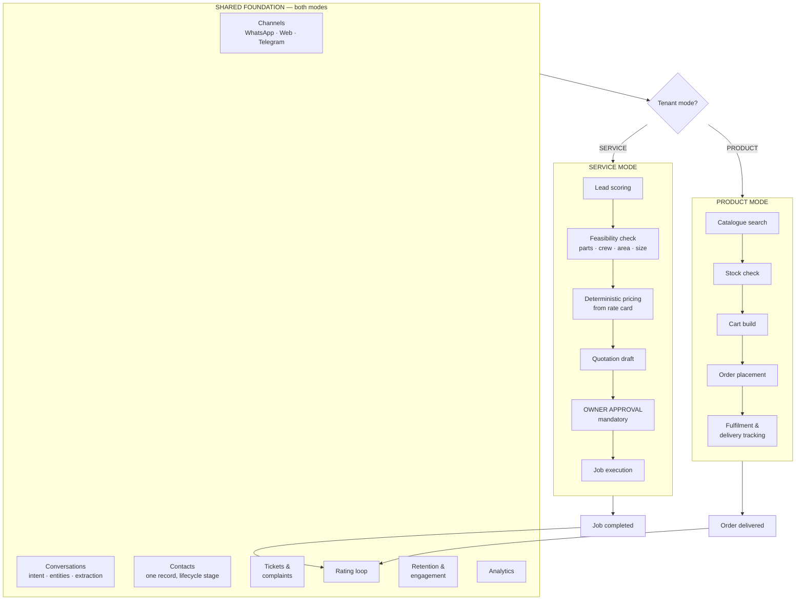

### Why one platform and not two products

The shared foundation is roughly 60% of the engineering. Channels, conversation
handling, the contact record, tickets, ratings and retention are identical in
both modes. Building them twice would be the "fork means two products and half
the engineering time" failure the architecture rules exist to prevent (§5.3).

The modes differ only in the **decision layer** — what happens between
"understood the customer" and "produced an outcome."

### What is explicitly not supported in v1

A tenant being **both modes at once**. A solar firm that sells panels online *and*
quotes installations is a real business shape, and the design does not forbid it
later — but one conversation needing both paths is a routing problem we are not
solving yet. See §16.4.

---

## 4. Feature inventory

The question "what does this system do" answered concretely, grouped by how
common the feature is in comparable products. This grouping is a **competitive
claim**, and the fresh market research will test it.

### 4.1 Common features — table stakes

Every serious competitor has these. Not having them is disqualifying; having them
is not an advantage.

| Feature | Mode | Notes |
|---|---|---|
| Inbound message handling on WhatsApp | Both | The primary surface |
| Intent classification | Both | Order, enquiry, complaint, feedback, other |
| Entity extraction | Both | Product, quantity, location, dates |
| FAQ / knowledge answering | Both | Shipping, returns, hours, policies |
| Conversation history, readable by the owner | Both | Trust feature; see §4.4 |
| Handoff to a human, and back | Both | Staff takes over a live conversation |
| Product search and questions | Product | Catalogue lookup |
| Order status and delivery tracking | Product | Reads the order record |
| Basic analytics dashboard | Both | Volume, conversion, response time |
| Multi-tenant isolation | Both | Structural, not a feature you can add later |

### 4.2 Uncommon features — the differentiators

Present in few or no comparable products. These are the reasons to build this
rather than buy something.

| Feature | Mode | Why it is uncommon |
|---|---|---|
| **Feasibility checking before pricing** | Service | Requires modelling parts stock, crew availability, service area and project-size bounds as live data. An LLM cannot fake it. **This is the single strongest differentiator.** |
| **Deterministic pricing with LLM narrative only** | Service | Most products let the model produce numbers. Ours computes the number in code and has the model write prose around it. |
| **Mandatory owner approval before anything reaches a customer** | Service | Competitors optimise for autonomy. We optimise for the owner's trust. |
| **Capacity-aware quotation** | Service | A quote that accounts for whether the crew is free next week |
| **One decision layer across two business kinds** | Both | Competitors specialise in one or the other |
| **Catalogue source abstraction** | Product | Serves shops with no Shopify and no proper website — see §9 |
| **Rating loop wired to suppression** | Both | A 1-star rating suppresses promotional messages for 72h. Most products have ratings and promos as unconnected features. |
| **Per-tenant AI cost metering** | Both | `usage_events` from day one. Most SaaS discovers this problem after it hurts. |
| **Compliance built into the flow** | Both | AI disclosure logged as an event; no terminal auto-rejection. See §17. |

### 4.3 Supporting features — the ALMA inheritance

Real features, phased. Each is marked with its target phase (§16).

| Feature | Phase | Notes |
|---|---|---|
| Complaints and ticketing | v1 | With escalation and SLA tracking |
| Post-delivery rating loop | v1 | 1–5, with branching actions |
| Coupons | v2 | Types, validation, abuse caps, redemption analytics |
| Loyalty points | v2 | Balance, tiers, transactions |
| Referrals | v2 | Codes, conversion tracking, rewards |
| Retention campaigns | v2 | Win-back, dormancy, seasonal, maintenance-due |
| Segments | v2 | Saved filters over the contact base |
| A/B experiments | v3 | Variant assignment, outcome tracking |
| Churn / reorder prediction | v3 | Per-contact propensity scores |
| CLV estimation | v3 | Past and predicted |
| Personas | v3 | Behavioural labels |
| Self-learning loop | v3 | Staff labels feed retraining |
| Knowledge base with retrieval | v2 | Per-tenant policy and FAQ answering |

### 4.4 The trust features

Called out separately because they are easy to skip and fatal to skip.

No business owner will let a machine talk to their customers without these:

1. **The conversation viewer.** The owner reads exactly what the agent said, word
   for word. Not a summary.
2. **Failure surfacing.** When the agent cannot handle something it says so and
   flags the conversation, rather than guessing.
3. **The approval gate.** In service mode, nothing reaches a customer unapproved.
4. **Sandbox mode.** The owner chats with their own agent before going live.
5. **Human takeover.** Any staff member can take over mid-conversation.

---

## 5. Architecture rules

Eight rules. They exist because breaking each one causes specific known damage.
Inherited from the spec §2, extended for the merge.

### 5.1 Channels are adapters, not the application

An inbound channel's only job: receive webhook → verify signature → persist raw
payload → enqueue → return 200. Outbound: normalised message → provider format →
send.

**No LLM call, no database join, no business logic on the webhook path.** WhatsApp
retries if you do not respond within seconds, and a slowly-processed webhook
becomes a duplicate reply to a real customer.

**Consequence:** the entire system must be testable and demonstrable with no live
WhatsApp connection.

### 5.2 Not everything is AI

| Concern | Implementation |
|---|---|
| Intent, entities, sentiment, dialogue, requirement extraction | **LLM** |
| Quotation covering narrative — wording only | **LLM** |
| Product search ranking | Database / vector search, not LLM |
| Lead scoring | **scikit-learn** |
| Feasibility checks | **Deterministic Python** |
| Pricing arithmetic | **Deterministic Python** |
| Order and job state transitions | Deterministic |
| Stock and cart arithmetic | Deterministic |
| Engagement guardrails | Deterministic |

**Pricing must never be produced by an LLM.** The model writes prose around a
number that deterministic code computed. This boundary is the primary defence
against "this is just a wrapper around a language model."

### 5.3 Multi-tenant shared schema, never custom builds

- One codebase, one database.
- `tenant_id` on every table.
- Postgres Row-Level Security as a **backstop**, not the primary filter.
  Application code filters by tenant; RLS catches the query that forgot.
- Every index leads with `tenant_id` — `(tenant_id, created_at)`,
  `(tenant_id, status)`.
- Customisation via **configuration, not code**: vertical configs, per-tenant
  pricing rules, prompts and templates as data, feature flags per plan tier.
- **Never fork per client.** A fork means two products and half the engineering
  time.

### 5.4 Modular monolith, not microservices

One FastAPI deployable. Hard module boundaries enforced by interface contracts.
Each module owns its tables; nothing reaches into another module's tables.

Peak load is around 20 requests/second. Microservices would buy independent
scaling we do not need, and charge us network failures, distributed tracing,
service discovery and cross-service consistency. Any module can be extracted
later because the interface already exists.

### 5.5 Event-driven internally, via transactional outbox

Postgres outbox table plus Celery consumers. Not Kafka. Modules publish events
and subscribe to what they care about. The `feedback` module listens for
`job.completed` and `order.delivered` and knows nothing about either module's
internals.

**This decoupling is what keeps the merged halves from tangling.**

### 5.6 State lives in Postgres, never in worker memory

Redis caches the last N conversation turns. Any worker must be able to pick up
any turn of any conversation. Horizontal scaling becomes a config change rather
than a rewrite.

### 5.7 Idempotency everywhere

- Unique constraint on `(tenant_id, provider_message_id)` for inbound.
- Dedupe key on every outbound send.
- Test by deliberately replaying a webhook.

A double-sent quotation, or a double-placed order, is an account-losing bug.

### 5.8 Analytics never queries live operational tables

Scheduled jobs precompute `daily_rollups`. The dashboard reads only from there.

### 5.9 New rule — external systems of record are adapters too

Where a tenant's catalogue or orders live in Shopify, **Shopify is the system of
record and we hold a synchronised read model.** The agent always queries our read
model, never the external API on the conversation path. See §9.

Rationale: consistent latency, identical behaviour across catalogue sources, and
distance from third-party rate limits.

---

## 6. High-level architecture

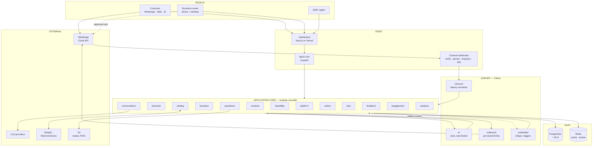

### The stack

| Layer | Choice | Notes |
|---|---|---|
| Frontend | Next.js + Tailwind on Vercel | Server components; mobile web is first-class |
| Backend | Python 3.12 + FastAPI | Stateless |
| ORM / migrations | SQLAlchemy 2.0 + Alembic | Non-negotiable for an evolving multi-tenant schema |
| Database | PostgreSQL (managed) | `jsonb` for flexible fields |
| Cache / broker | Redis | Hot conversation window, rate-limit counters, Celery broker |
| Async | Celery + Celery Beat | Four queues, split by workload class |
| LLM | Direct SDK calls + Pydantic structured output | **No LangChain in the core path** — see §18.3 |
| ML | scikit-learn | Lead scoring, later propensity |
| Search | Postgres full-text, then pgvector | Catalogue search; avoid a separate search service |
| Channels | WhatsApp Cloud API (official) | **Never** WhatsApp Web automation providers |
| Auth | JWT with tenant claim, short access + refresh, RBAC | owner / manager / agent |
| Files | S3 | Media, quotation PDFs |
| Observability | Structured JSON logs with request ID, Sentry, per-tenant usage | Cheap now; proves the scalability claim |
| Deploy | Docker Compose on a single instance | Resist Kubernetes. Path to ECS/Fargate is a config change because code is stateless |

### Queue split rationale

| Queue | Character |
|---|---|
| `inbound` | Latency-sensitive — a customer is actively waiting |
| `ai` | Slow, expensive, externally rate-limited |
| `outbound` | Rate-limited per tenant per channel |
| `scheduled` | Nightly rollups, rating triggers, retention sends, catalogue reconciliation |

A nightly analytics job must never sit in front of a customer's reply.

---

## 7. Module catalogue

Thirteen modules. Origin markers: **[L]** LeadCraft, **[A]** ALMA, **[N]** new to
the merge.

| # | Module | Origin | Owns | Responsibility | Mode |
|---|---|---|---|---|---|
| 1 | `platform` | [N] | `tenants`, `users`, `roles`, `plans`, `feature_flags`, `usage_events`, `audit_log` | Tenancy, auth, RLS enforcement, LLM and message metering per tenant | Both |
| 2 | `channels` | [L+A] | `channels`, `messages`, `outbound_queue`, `consents`, `message_templates` | Provider adapters, inbound normalisation, single outbound dispatcher with dedupe, backoff, per-tenant rate limits and DLQ | Both |
| 3 | `conversations` | [L+A] | `conversations`, `conversation_state`, `extracted_requirements` | Turn router, intent classification, entity and requirement extraction, sentiment for routing, human handoff | Both |
| 4 | `business` | [L] | `businesses`, `services`, `pricing_rules`, `service_areas`, `inventory_items`, `workforce`, `verticals`, `branches` | Tenant configuration as data — the thing that makes customisation codeless | Service |
| 5 | `catalog` | **[N]** | `catalog_sources`, `products`, `product_variants`, `stock_levels` | Catalogue ingestion behind one port; sync, reconciliation, search index | Product |
| 6 | `contacts` | [L+A] | `contacts` (with `lifecycle_stage`), `lead_scores`, `contact_metrics` | The unified lead-and-customer record, scikit-learn scoring, RFM and derived metrics | Both |
| 7 | `feasibility` | [L] | `feasibility_results` | Deterministic rules: service match, area match, parts sufficiency, crew availability, size bounds. **Zero LLM.** | Service |
| 8 | `quotations` | [L] | `quotations`, `quotation_items`, `approvals` | Deterministic pricing and margin, optional Good-Better-Best tiers, LLM narrative, approval workflow, PDF generation | Service |
| 9 | `orders` | **[A+N]** | `orders`, `order_items`, `order_events`, `carts`, `payments`, `deliveries` | Cart, order placement, fulfilment state, delivery tracking, cancellation, refunds | Product |
| 10 | `jobs` | [A] | `jobs`, `job_events` | Accepted quotation becomes a job. Parts reserved, crew allocated, append-only timeline. **The merge seam.** | Service |
| 11 | `feedback` | [A] | `feedback`, `tickets` | Delayed rating trigger, 1–5 capture, branching auto-actions, complaint handling and escalation | Both |
| 12 | `engagement` | [A] | `campaigns`, `retention_triggers`, `coupons`, `loyalty`, `referrals`, `suppression_rules`, `segments` | Scheduled outbound, next-best-action policy, consent, fatigue and post-complaint guardrails | Both |
| 13 | `analytics` | [L] | `daily_rollups` | Precomputed aggregates for the dashboard | Both |

### Module dependency graph

Arrows point from consumer to provider. No cycles — this is enforced.

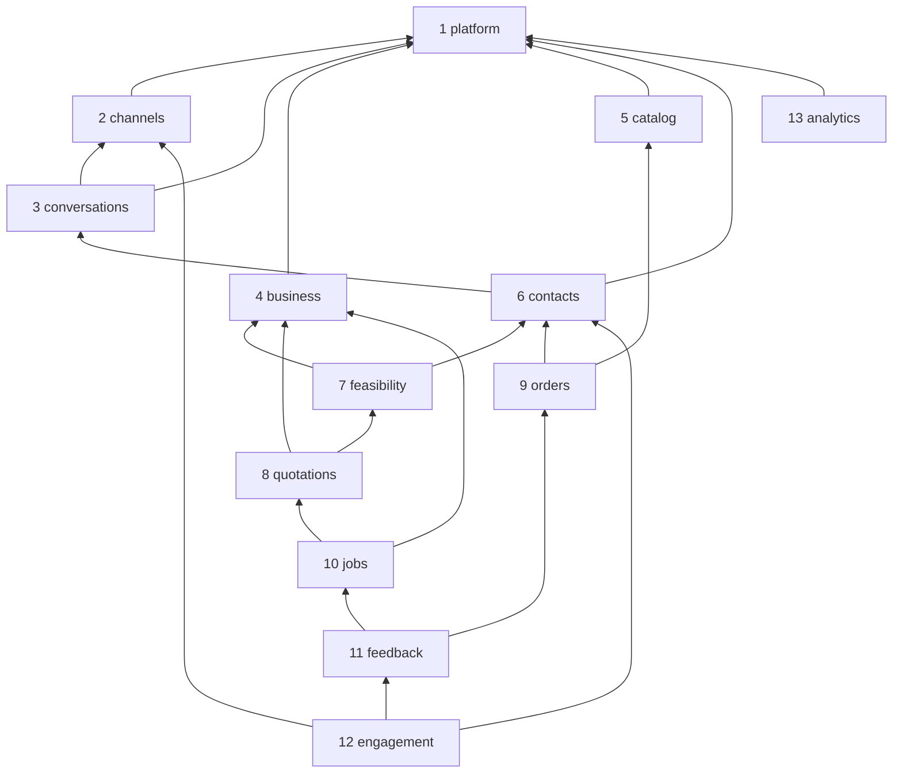

`feedback` depending on both `jobs` and `orders` is the shared rating loop. That
convergence is the merge working correctly.

---

## 8. Low-level architecture

### 8.1 The inbound path, layer by layer

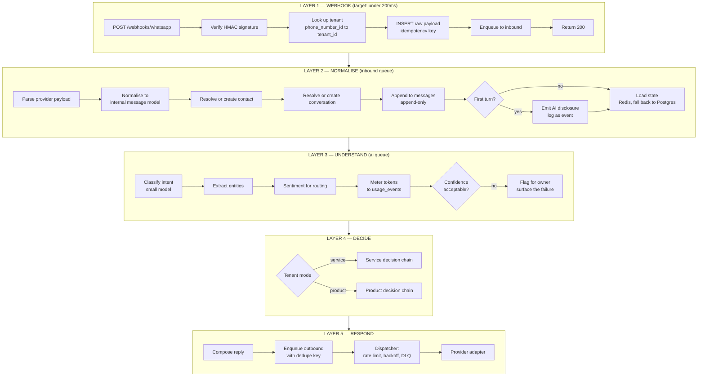

### 8.2 The service decision chain

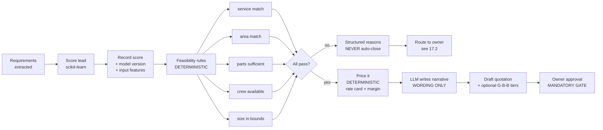

The five feasibility checks run in parallel and **each returns a reason**, not
just a boolean. That is both a product requirement (the owner needs to know why)
and a compliance requirement (§17.2).

### 8.3 The product decision chain

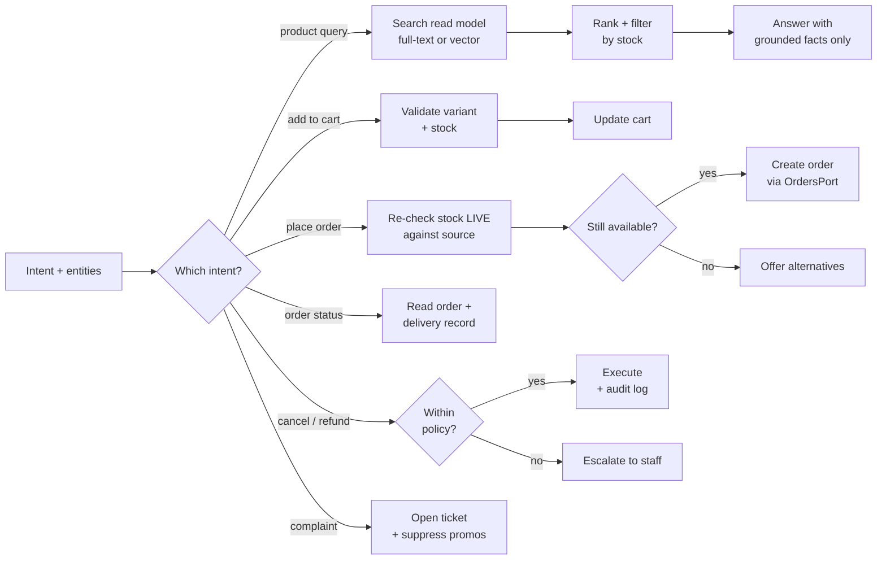

Two details that matter:

- **Answer with grounded facts only.** The agent must never invent a product,
  price or delivery date. Responses about the catalogue are composed from
  retrieved records, not generated from the model's memory.
- **Re-check stock live before committing an order.** The read model is fast but
  may be seconds or hours stale depending on the source. The commit path pays the
  latency cost to avoid promising sold-out stock.

### 8.4 Sentiment and confidence handling

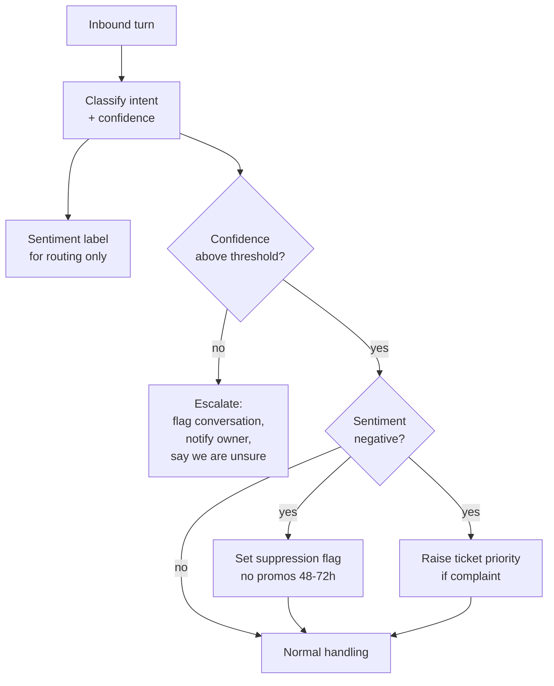

⚠️ **Deliberate naming.** This is **sentiment classification for routing and
escalation**, operating on message text only. It is not emotion recognition and
must never be described as inferring a person's emotional state. ALMA's
"Emotion Brain" and `EmotionalJourney` table are rescoped accordingly — see
§10.6 and §17.5.

---

## 9. The catalogue and orders ports

The newest part of the design, and the answer to *"every business stores products
differently."*

### 9.1 The problem

A tenant's products might live in Shopify, in WooCommerce, in a custom website's
database, in a spreadsheet, or nowhere at all except the owner's head. A SaaS
product cannot have a bespoke integration per tenant — that is the consulting
economics the whole positioning rejects.

### 9.2 The answer — ports and adapters, again

The same rule that makes WhatsApp an adapter (§5.1) makes Shopify an adapter.

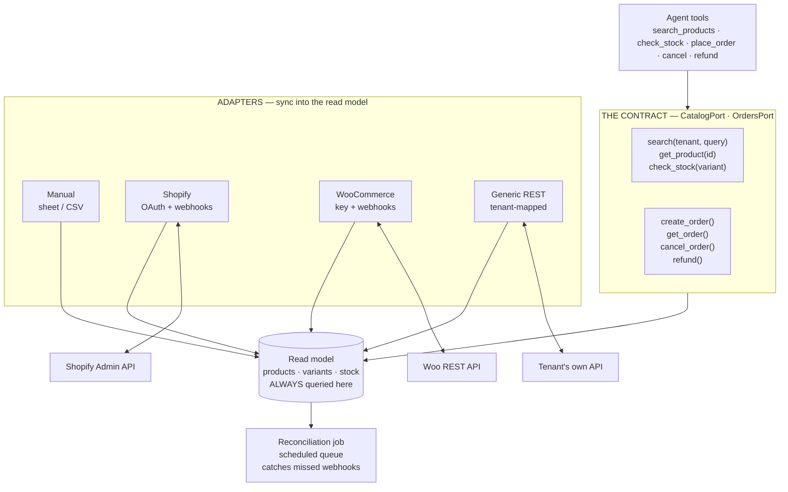

**The interface is the product. The adapters are inventory.** Once
`search_products(tenant, query) → Product[]` is fixed, every source is a shim
behind it. A new platform is contained work, not a redesign.

### 9.3 Build order, and why

| Order | Adapter | Reasoning |
|---|---|---|
| **1st** | **Manual — sheet / CSV** | The universal fallback. Works for any tenant on any platform, including those with no website. Forces the canonical product model to be defined before any external API shapes it. Cheapest to build. Serves the ALMA-shaped tenant directly. |
| 2nd | **Shopify** | Best API, cleanest OAuth, real global store count. The "one click and you are live" demo. |
| 3rd | **WooCommerce** | Likely the higher store count in several target markets. ⚠️ Verify against the actual sales pipeline before committing. |
| 4th | **Generic REST** | The escape hatch for custom builds. Tenant maps their own endpoints to the canonical schema through a config UI. Makes "custom catalogue" configuration rather than a project. |

Building the adapter with *no* API first is what keeps the port honest.

### 9.4 Freshness is a first-class concept

Different sources have wildly different staleness, and the agent must know which
it is dealing with.

| Source | Mechanism | Realistic lag |
|---|---|---|
| Shopify | Webhooks + reconciliation | Seconds |
| WooCommerce | Webhooks (less reliable) + poll | Minutes |
| Generic REST | Scheduled poll | Minutes to hours |
| Manual sheet | Re-upload by the owner | **Days** ⚠️ |

Every product record carries `last_synced_at` and a `stock_confidence` value.
"In stock" from a Shopify webhook and "in stock" from a spreadsheet uploaded last
Tuesday are not the same claim. The agent hedges its language accordingly, and
the commit path always re-checks live.

### 9.5 Source of truth, stated plainly

Where an external platform is connected, **it is the system of record.** We hold
a read model and never write catalogue data back except through the platform's
own API.

This resolves an ambiguity worth naming: an earlier plan had tenants maintaining
a product sheet *and* connecting Shopify. That is two sources of truth and it
ends with the agent quoting prices that do not exist. One source per tenant,
declared in `catalog_sources`.

### 9.6 What Shopify replaces, and what stays ours

| Concern | Shopify tenant | Sheet tenant |
|---|---|---|
| Products, variants, prices | Shopify | Ours |
| Stock levels | Shopify | Ours |
| Orders, payments | Shopify | Ours |
| Conversations, intents | **Ours** | Ours |
| Contact record, lifecycle | **Ours** | Ours |
| Tickets, complaints | **Ours** | Ours |
| Ratings, retention | **Ours** | Ours |
| Coupons as policy | **Ours** | Ours |

The conversational and lifecycle layer is ours in every case. That is the product.

### 9.7 Reconciliation — the thing nobody plans for

Webhook delivery is not guaranteed. A missed `product.updated` means a wrong
price in the read model, indefinitely.

Every connected source gets a scheduled reconciliation job: delta sync on an
`updated_at` watermark, periodic full sync, and drift detection. ALMA already had
the right shape for this — `JobStatus`, `WebhookLogs` with retry counts,
`DataErrors`. Those carry into the design.

---

## 10. Data model

Around 25 core tables. **Not 60.** `jsonb` carries the flexible parts —
extracted requirements, raw payloads, per-vertical fields, derived metric bundles
— giving schema flexibility without table sprawl.

### 10.1 Entity relationship overview

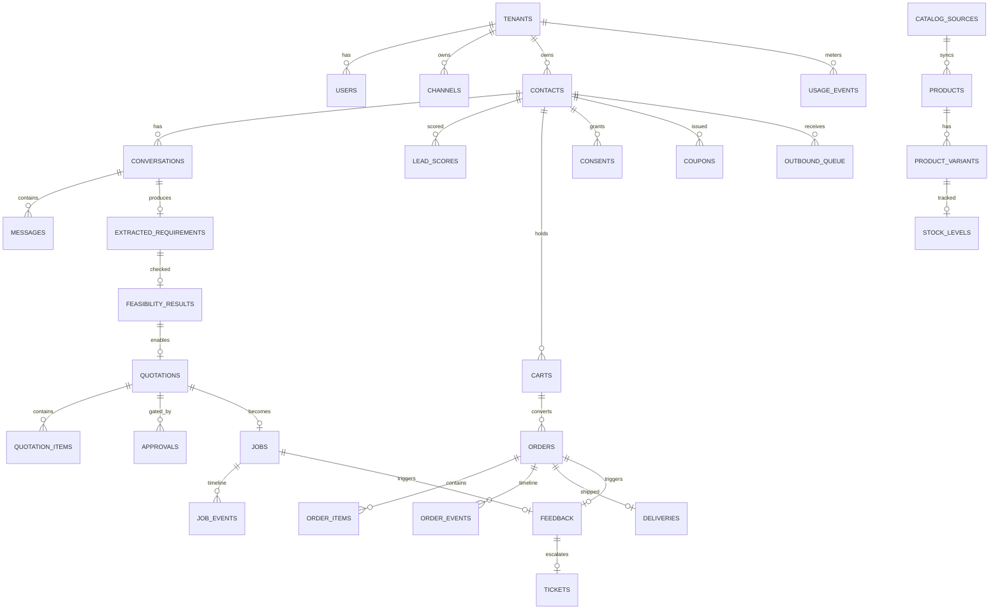

### 10.2 Core tables by module

**platform**
- `tenants` — id, name, mode (`service` / `product`), region, plan, status, locale, timezone
- `users` — per-tenant accounts, role (`owner` / `manager` / `agent`)
- `plans`, `feature_flags` — tier capabilities as data
- `usage_events` — **every LLM call, every message, per tenant.** Non-negotiable in v1
- `audit_log` — owner actions: approvals, edits, config changes

**channels**
- `channels` — `provider_phone_number_id → tenant_id` routing, encrypted tokens, health
- `messages` — append-only, unique `(tenant_id, provider_message_id)`
- `outbound_queue` — dedupe key, attempts, status, scheduled_at
- `outbound_dlq` — parked failures with replay
- `consents` — type, granted, timestamp, source, `consent_text_version`
- `message_templates` — per tenant and global

**conversations**
- `conversations` — contact, channel, state, session boundaries, assigned staff
- `conversation_state` — current step, slots filled, `jsonb`
- `extracted_requirements` — per-vertical JSON schema output

**business** (service mode)
- `businesses`, `services`, `pricing_rules`, `service_areas`
- `inventory_items` — parts stock for feasibility
- `workforce` — crews and availability
- `verticals` — configuration, not code
- `branches` — physical locations

**catalog** (product mode)
- `catalog_sources` — adapter type, encrypted credentials, sync mode, last sync, health
- `products` — canonical model, `external_id` + `source`, `raw_json`
- `product_variants` — SKU, price, the part flat sources synthesise
- `stock_levels` — quantity, policy, `last_synced_at`, `stock_confidence`

**contacts**
- `contacts` — **the unified record**, with `lifecycle_stage`
- `lead_scores` — score, **model version, input features** (§17.3)
- `contact_metrics` — RFM, derived values, `jsonb` bundle

**feasibility**
- `feasibility_results` — verdict, **structured reasons**, inputs snapshot

**quotations**
- `quotations` — status, totals, narrative, PDF reference
- `quotation_items` — line items
- `approvals` — who, when, what changed, decision

**orders**
- `carts`, `orders`, `order_items`
- `order_events` — append-only timeline, from/to status
- `payments`, `deliveries`

**jobs**
- `jobs` — from accepted quotation, parts reserved, crew allocated
- `job_events` — append-only timeline

**feedback**
- `feedback` — 1–5 rating, text, rated_at, source (job or order)
- `tickets` — type, status, priority, resolution, escalation

**engagement**
- `campaigns`, `retention_triggers`, `segments`
- `coupons` — type, rules, caps, redemption
- `loyalty_transactions`, `referrals`
- `suppression_rules` — consent, fatigue, post-complaint

**analytics**
- `daily_rollups` — precomputed, the only table the dashboard reads

### 10.3 The two modelling decisions that define the merge

**1. One `contacts` table with `lifecycle_stage`.** A lead and a customer are the
same entity at different stages. This single decision is what makes the system one
product rather than two apps sharing a database.

```
new_inquiry → qualified → quoted → customer → repeat → dormant → churned
```

**2. An accepted quotation becomes a job.** The transition is the hinge between
the two halves. Same underlying commitment, different name either side.

### 10.4 Lifecycle context in conversation routing

A powerful consequence of the unified contact record: an inbound message is
interpreted differently depending on where the sender sits in their lifecycle.

| Sender state | Same message means |
|---|---|
| Unknown number | New inquiry — start qualification |
| Open job or order | Service question about that job |
| Recently completed | Feedback, or a warranty issue |
| Dormant customer | Repeat business opportunity |

This is cheap to implement and makes the agent feel substantially more competent.

### 10.5 Indexing rules

Every index leads with `tenant_id`. RLS policies on every tenant-scoped table as
a backstop. The only unbounded-growth table is `messages` — around 9M rows a year
at 200 tenants, which Postgres handles fine. Design append-only now, plan monthly
partitioning as a later migration. **Do not build partitioning yet.**

### 10.6 ALMA's schema, collapsed

ALMA specified **58 tables** across an Admin Hub and per-tenant Store Files. That
count is a consequence of Google Sheets, which has no `jsonb` and no joins worth
using, so every derived metric became its own column or tab.

Lifted literally into Postgres it would be table sprawl, and the spec explicitly
warns against exactly this ("~16–18 core tables. Not 60").

| ALMA tables | Collapsed to |
|---|---|
| `Customers` with ~50 analytics columns | `contacts` + `contact_metrics` (`jsonb`) |
| `FeatureStore_CustomerDaily`, `FeatureStore_ProductDaily` | `daily_rollups` |
| `CustomerPersona`, `EmotionalJourney`, `BehavioralSignals` | `contact_metrics` (`jsonb`), rescoped — see §17.5 |
| `SentimentLog` | A column on `messages` |
| `SLA_Metrics` | Derived from `order_events` timestamps |
| `TrainingData_NLU`, `_Sentiment`, `_Reco` | One `training_samples` table with a `task` column |
| `Lookups_*` (regions, brands, flavours, categories) | `jsonb` config on `verticals`, or reference tables |
| `NameCorrections`, `Dedup_MergeMap`, `ReverseGeocoding_Cache` | Utility tables, kept as-is |
| Admin Hub / Store File split | **Not needed.** Shared schema with `tenant_id` and RLS achieves the same isolation in one database |

**What carries over unchanged, because it was right:**

- `tenant_id` on every row — ALMA insisted on this even inside isolated files,
  specifically to survive the migration to a database. Good instinct, vindicated.
- Central `OutboundQueue` with `dedupe_key` plus a dead-letter table.
- `OrderEvents` as an append-only from/to-status timeline.
- Meta columns: `raw_json`, `created_at`, `updated_at`, `source`.
- `WebhookLogs`, `JobStatus`, `DataErrors` for operational visibility.
- The model registry idea — `AI_Models` with metrics and version — which lines up
  with the compliance requirement to record model version per score (§17.3).

⚠️ **Two ALMA decisions deliberately reversed:**

1. **`ChannelsRegistry.provider` listed `greenapi`.** Rejected. WhatsApp Web
   automation providers get numbers banned on exactly the outbound retention
   traffic this product depends on. Official Cloud API only.
2. **Inventory tables were excluded by choice.** Reinstated, because feasibility
   in service mode depends on parts stock, and product mode depends on stock
   levels. This was the right call for a vape retailer and the wrong one for the
   merged platform.

---

## 11. Event contracts

Modules communicate by publishing to a Postgres outbox table. Celery consumers
deliver. No module reaches into another's tables.

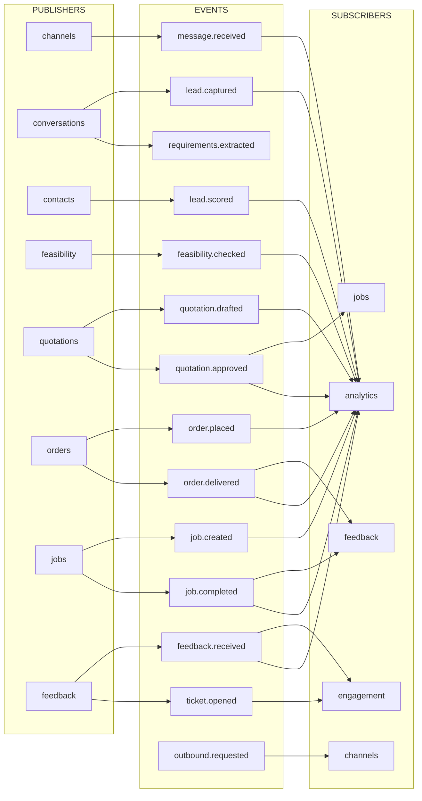

### Key subscriptions

| Subscriber | Listens for | Why |
|---|---|---|
| `feedback` | `job.completed`, `order.delivered` | Fires the delayed rating trigger. **The shared seam.** |
| `engagement` | `feedback.received`, `ticket.opened` | Applies promo suppression on low scores and complaints |
| `jobs` | `quotation.approved` + customer acceptance | Creates the job |
| `analytics` | All events | Rollup aggregation |
| `channels` | `outbound.requested` | Dispatches |

⚠️ **Open:** event payload shapes are not yet specified. Flagged in the spec as
TBD and still outstanding. See §16.5.

---

## 12. Use case diagram

```mermaid
flowchart TB
    subgraph actors_l[" "]
        CU(["Customer"])
        OW(["Business owner"])
    end

    subgraph system["THE PLATFORM"]
        direction TB

        subgraph uc_shared["Shared"]
            U1["Send enquiry"]
            U2["Hold qualifying<br/>conversation"]
            U3["Receive AI<br/>disclosure"]
            U4["Give rating"]
            U5["Raise complaint"]
            U6["Read conversation<br/>history"]
            U7["Take over<br/>conversation"]
            U8["View analytics"]
            U9["Request data<br/>export or erasure"]
        end

        subgraph uc_svc["Service mode"]
            U10["Get requirements<br/>extracted"]
            U11["Be scored"]
            U12["Have feasibility<br/>checked"]
            U13["Receive quotation"]
            U14["Approve or reject<br/>quotation"]
            U15["Edit before<br/>approving"]
            U16["Configure pricing,<br/>parts, crews, areas"]
        end

        subgraph uc_prd["Product mode"]
            U17["Search products"]
            U18["Check stock"]
            U19["Build cart"]
            U20["Place order"]
            U21["Track delivery"]
            U22["Cancel order"]
            U23["Request refund"]
            U24["Connect catalogue<br/>source"]
        end
    end

    subgraph actors_r[" "]
        ST(["Staff / agent"])
        SY(["System<br/>scheduled"])
        EX(["External<br/>Shopify · WhatsApp · LLM"])
    end

    CU --> U1 & U2 & U3 & U4 & U5
    CU --> U10 & U11 & U12 & U13
    CU --> U17 & U18 & U19 & U20 & U21 & U22 & U23
    CU --> U9

    OW --> U6 & U7 & U8
    OW --> U14 & U15 & U16
    OW --> U24

    ST --> U6 & U7 & U5

    SY --> U4
    SY --> U11 & U12

    EX --> U17 & U18 & U20
```

### Include and extend relationships

| Use case | Relationship | Target |
|---|---|---|
| Hold qualifying conversation | **includes** | Receive AI disclosure |
| Hold qualifying conversation | **includes** | Get requirements extracted |
| Have feasibility checked | **includes** | Be scored |
| Receive quotation | **includes** | Approve or reject quotation |
| Approve or reject quotation | **extends** | Edit before approving |
| Place order | **includes** | Check stock |
| Place order | **includes** | Build cart |
| Request refund | **extends** | Cancel order |
| Give rating | **extends** | Raise complaint *(when rating is 1–2)* |
| Any automated outcome | **extends** | Request human review *(§17.2)* |

---

## 13. Activity diagrams

### 13.1 High-level — the full lifecycle, both modes

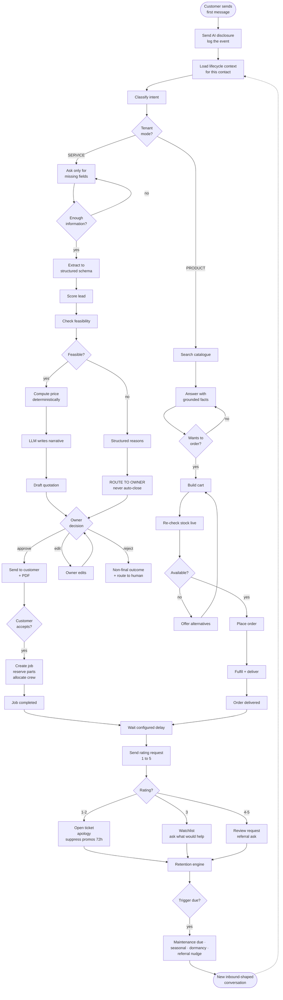

The dotted line from retention back to context loading is the loop closing.
Stage 11 returns to Stage 2.

### 13.2 Swimlane — service mode quotation

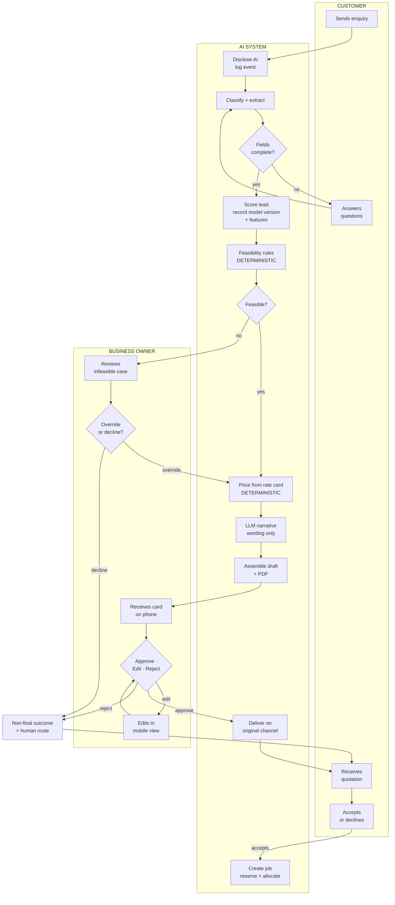

Note the **infeasible branch routes to the owner**, never to an automatic close.
That is a compliance requirement, not a preference — see §17.2.

### 13.3 Swimlane — product mode order

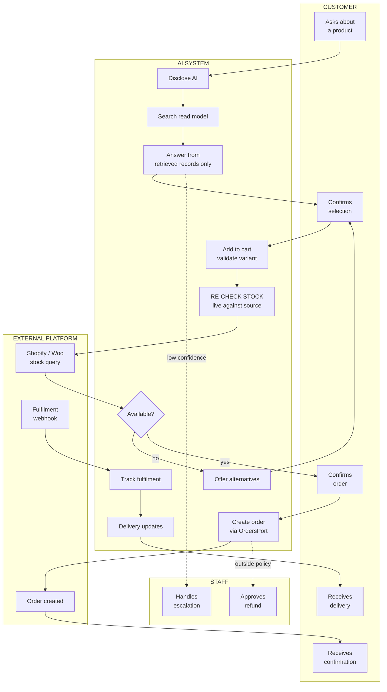

### 13.4 Catalogue sync activity

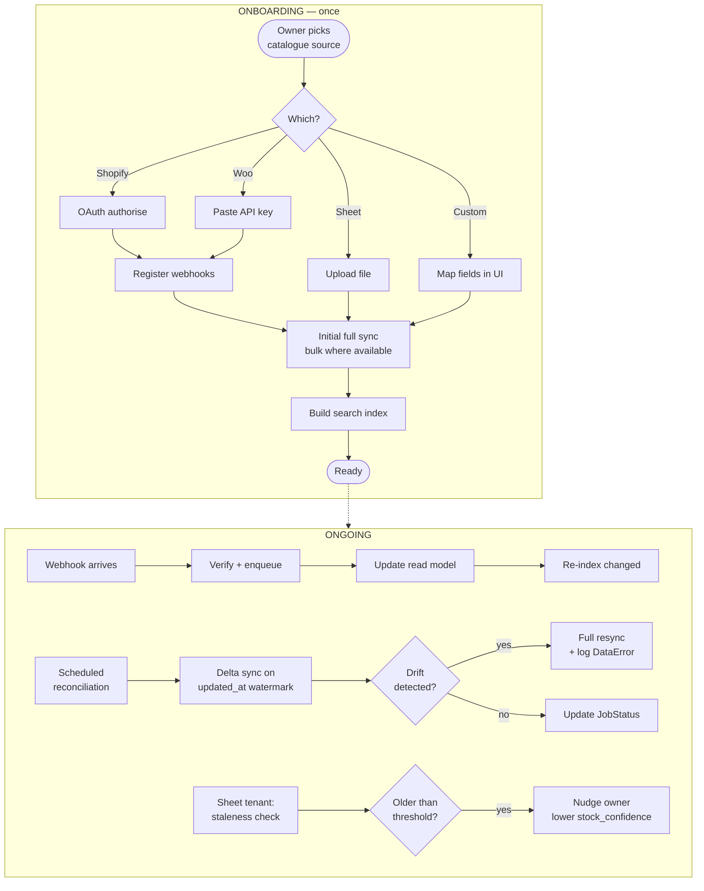

---

## 14. State diagrams

### 14.1 Contact lifecycle — the unified record

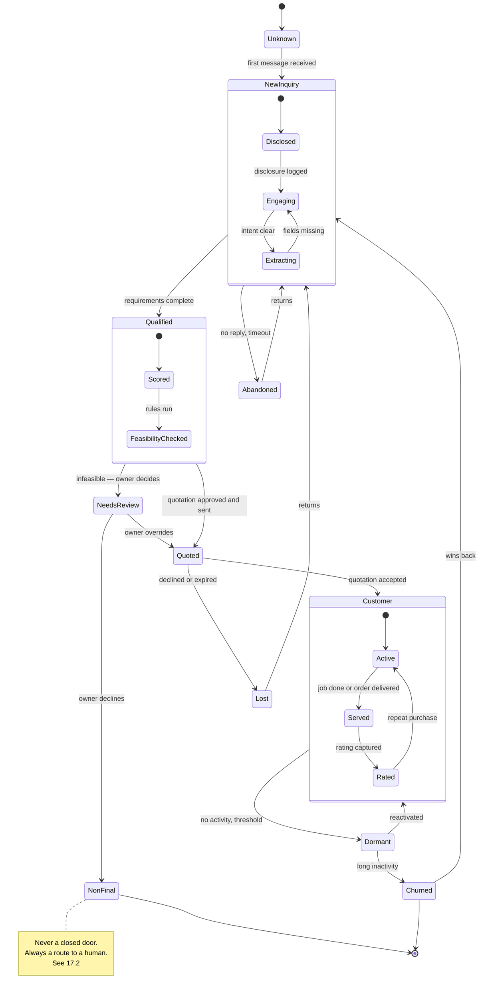

### 14.2 Quotation state

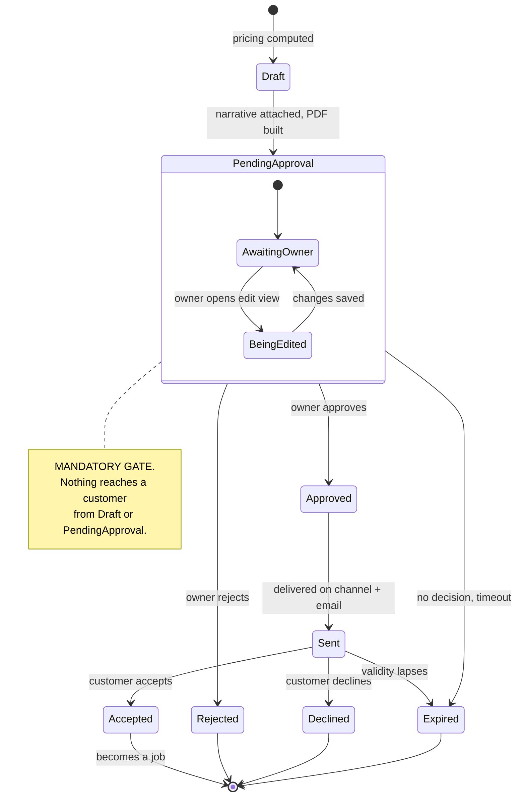

### 14.3 Order state

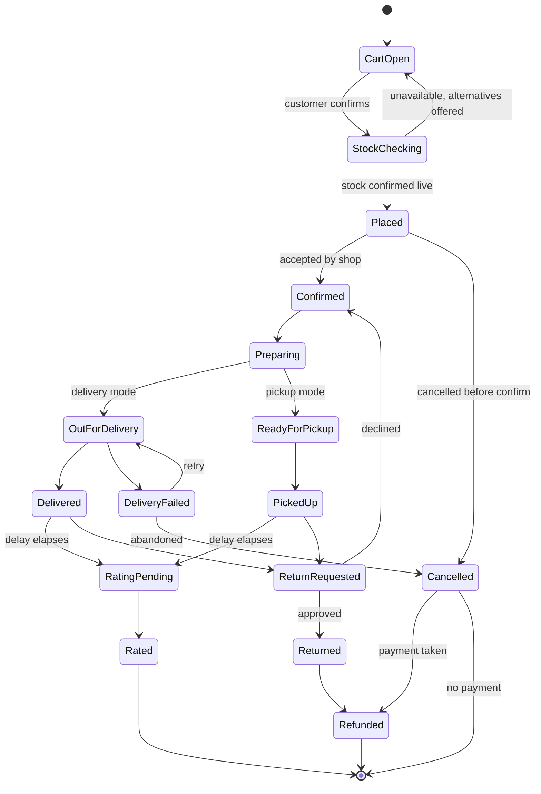

### 14.4 Job state — service mode

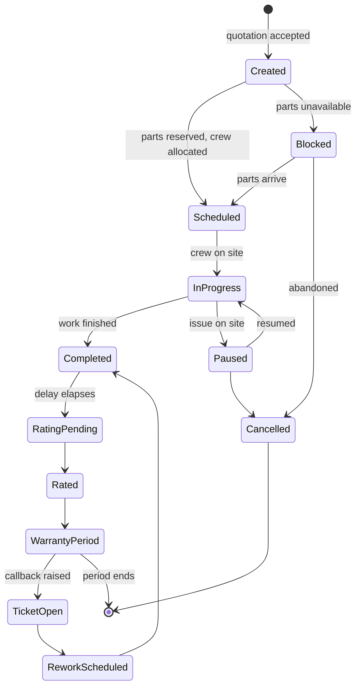

### 14.5 Conversation state

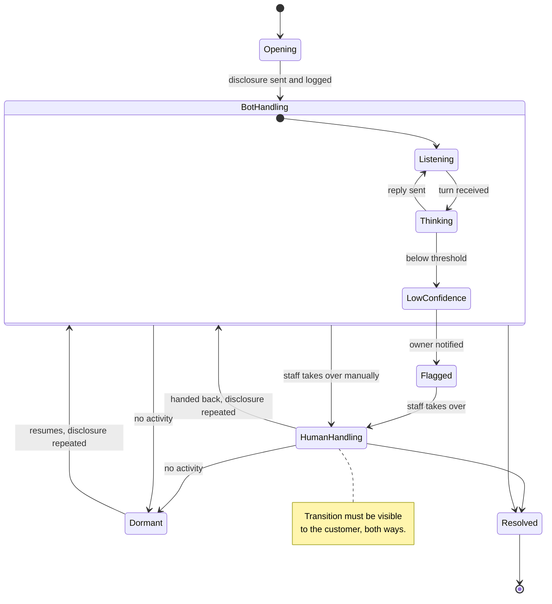

---

## 15. Sequence diagrams

### 15.1 Inbound message — the critical path

```mermaid
sequenceDiagram
    participant C as Customer
    participant WA as WhatsApp
    participant WH as Webhook
    participant Q as Celery
    participant CO as conversations
    participant LLM as LLM
    participant DB as Postgres
    participant D as Dispatcher

    C->>WA: "I need a 10kW solar system"
    WA->>WH: POST webhook
    WH->>WH: verify HMAC
    WH->>DB: lookup tenant by phone_number_id
    WH->>DB: INSERT raw payload (idempotent)
    WH->>Q: enqueue inbound
    WH-->>WA: 200 OK
    Note over WH,WA: under 200ms — no LLM, no joins

    Q->>CO: process
    CO->>DB: resolve contact + conversation
    CO->>DB: append message
    CO->>Q: enqueue ai
    Q->>LLM: classify + extract
    LLM-->>Q: structured output
    Q->>DB: record usage_events
    Q->>DB: persist extraction
    Q->>D: enqueue outbound (dedupe key)
    D->>D: rate limit check
    D->>WA: send reply
    WA->>C: reply delivered
```

### 15.2 Quotation approval on the owner's phone

```mermaid
sequenceDiagram
    participant S as System
    participant WA as WhatsApp
    participant O as Owner
    participant API as API
    participant DB as Postgres
    participant C as Customer

    S->>DB: quotation → PendingApproval
    S->>WA: template message
    Note over S,WA: pre-approved template:<br/>name, amount, score,<br/>feasibility verdict,<br/>Approve/Reject buttons,<br/>URL to edit view
    WA->>O: approval card

    alt Approve
        O->>WA: tap Approve
        WA->>API: quick-reply webhook
        API->>DB: record approval + audit
        API->>C: send quotation + PDF
    else Edit first
        O->>API: open URL button
        API-->>O: single-screen mobile view
        O->>API: save changes
        API->>DB: update items, recompute total
        O->>API: approve
        API->>C: send quotation + PDF
    else Reject
        O->>WA: tap Reject
        API->>DB: record rejection
        API->>C: non-final message + human route
    end
```

⚠️ The approval notification is business-initiated and therefore needs a
**pre-approved WhatsApp template**. Approval takes weeks. Submit early — a demo
that cannot send its own approval notification is an avoidable disaster.

### 15.3 Catalogue sync — Shopify

```mermaid
sequenceDiagram
    participant O as Owner
    participant UI as Dashboard
    participant API as API
    participant SH as Shopify
    participant Q as Celery
    participant DB as Read model

    O->>UI: Connect Shopify
    UI->>SH: OAuth authorise
    SH-->>API: callback with code
    API->>SH: exchange for token
    API->>DB: store encrypted in catalog_sources
    API->>SH: register webhooks
    Note over API,SH: products/update,<br/>inventory_levels/update,<br/>orders/create,<br/>plus mandatory<br/>compliance webhooks

    API->>Q: enqueue initial sync
    Q->>SH: bulk products query
    SH-->>Q: catalogue
    Q->>DB: upsert products + variants
    Q->>DB: build search index
    Q->>UI: ready

    loop Ongoing
        SH->>API: product updated
        API->>Q: enqueue
        Q->>DB: update + reindex
    end

    loop Scheduled
        Q->>SH: delta since watermark
        Q->>DB: reconcile drift
    end
```

### 15.4 The rating loop — shared by both modes

```mermaid
sequenceDiagram
    participant J as jobs / orders
    participant OB as Outbox
    participant FB as feedback
    participant B as Celery Beat
    participant CH as channels
    participant C as Customer
    participant EN as engagement

    alt Service mode
        J->>OB: job.completed
    else Product mode
        J->>OB: order.delivered
    end

    OB->>FB: deliver event
    FB->>B: schedule trigger (configurable delay)
    Note over FB,B: e.g. 90-180 min,<br/>or next morning per<br/>send-time preference

    B->>CH: send rating request
    CH->>C: 1-5 one-tap buttons
    C->>CH: taps 2
    CH->>FB: capture rating

    FB->>OB: feedback.received
    FB->>FB: open ticket, high priority
    OB->>EN: deliver event
    EN->>EN: suppress promos 72h

    Note over FB,EN: One mechanism,<br/>two entry points.<br/>This is the merge working.
```

---

## 16. Scope, phasing and gaps

### 16.1 The v1 thesis

> A business connects their channel, spends 30 minutes entering their
> configuration — services and pricing rules for a service tenant, or a
> catalogue connection for a product tenant. From then on, inbound customers are
> handled by conversation, checked against real business capacity or real stock,
> and turned into either a priced quotation the owner approves from his phone in
> under a minute, or a placed order.

If that is true and demonstrable, v1 is done. If any clause is missing, it is not.

### 16.2 Phasing

**v1 — the minimum coherent product**

| Area | Included |
|---|---|
| Platform | Tenants, auth, RBAC, plans, feature flags, **`usage_events` metering**, quota enforcement, audit log, region attribute |
| Onboarding | Guided wizard with partial save and skip-for-now, **sandbox test mode** |
| Channels | WhatsApp Cloud API, web widget, Telegram owner-side, health checks, encrypted tokens |
| Conversations | Normalisation, turn router, qualification dialogue, extraction, sentiment for routing, **human handoff**, **failure surfacing**, idempotency |
| Service decision | Lead scoring with model version and features, feasibility rules **with structured reasons**, deterministic pricing |
| Quotations | Draft, phone-first approval, edit before approve, PDF, delivery on channel, email option, status tracking |
| Catalogue | **Manual sheet/CSV adapter**, canonical model, search index, staleness handling |
| Product decision | Search, stock check, cart, order placement, delivery status, cancellation |
| Feedback | Rating loop both modes, tickets, complaint handling |
| Dashboard | Lead and order lists, **conversation viewer**, approval queue, config editing, basic analytics, usage display, new-lead notification |
| Operations | Outbound dispatcher with DLQ, four-queue split, outbox, structured logging, Sentry, tiered model routing, prompt caching, nightly rollups, **tested restore** |
| Compliance | The six engineering items — see §17.6 |

**v1.1**
- Shopify adapter
- Good-Better-Best quotation tiers
- Knowledge base with retrieval

**v2**
- WooCommerce adapter
- Coupons, loyalty, referrals
- Retention campaigns and segments
- Generic REST adapter

**v3**
- A/B experiments
- Churn, reorder propensity, CLV
- Personas
- Self-learning loop
- Instagram and Messenger

### 16.3 Explicitly out of scope, with reasons

| Item | Why |
|---|---|
| Scheduling, dispatch, calendars | Do not compete with established job-management software on its core |
| Payments and invoicing | Out per positioning |
| Route optimisation, GPS tracking | Not our problem |
| Payroll, timesheets | Not our problem |
| Accounting, ERP | Not our problem |
| Warehouse and procurement management | v1 checks availability; it does not manage ordering stock |
| Native mobile app | WhatsApp plus desktop covers both jobs. A PWA covers any later gap |
| Multi-location enterprise reporting | Wrong segment |
| Mapping and property measurement | A competitor's strength, not ours |
| Job-management API sync | The mid-term expansion play, after product-market fit |
| Marketplaces — Amazon, Noon, Daraz | The marketplace owns the customer conversation; our value is thinner there |
| Self-serve billing | See §16.5 |
| A tenant being both modes at once | See §16.4 |

### 16.4 Known gaps in the design

Things this document does not yet answer, that will need answering.

**Dual-mode tenants.** A solar firm that sells panels online and quotes
installations is a real shape. One conversation could need both paths — "do you
have 400W panels in stock, and can you install them?" The routing, the contact
record and the outcome model all get more complex. Deliberately deferred; the
architecture does not forbid it.

**Cross-mode inventory.** In service mode `inventory_items` feeds feasibility. In
product mode `stock_levels` feeds ordering. For a dual-mode tenant these are the
same physical stock and the models would need reconciling.

**Search quality.** The design says "Postgres full-text, then pgvector." Whether
that is good enough for conversational product search across a large catalogue is
untested. This is the highest technical risk in product mode.

**Refund authority.** How much an agent may refund without a human is stated as a
policy limit but not designed. Needs per-tenant configuration and an audit trail.

**Multi-language.** The agent talks to the public. Which languages, and whether
the extraction schemas and pricing narratives work in each, is unresolved and
depends on the market decision.

### 16.5 Open decisions

| Decision | Status |
|---|---|
| **Target market and country** | **DECIDED — UK + Ireland**, as one English-language market. Product is **English-only**; that constraint rules out the Netherlands and Sweden, where the agent would be answering the tenant's own customers in a foreign language (67.6% of Dutch firms deal externally in Dutch only; Swedish product information is legally required in Swedish). Sweden's channel mix is fine — Messenger 65%, Instagram 65% — so it reopens if Swedish support is ever built. See `STRATEGY_FINDINGS.md` §4 |
| **Which mode to lead with** | Open. Service has the stronger differentiator; product has the larger market. Research should inform it |
| Product name | Unresolved. Original name collides with an existing US company |
| Self-serve or invite-only provisioning | Invite-only recommended for v1 — removes signup abuse, payment automation and onboarding-at-scale from the critical path |
| First vertical for service mode | Solar assumed |
| Event payload shapes | **TBD.** Flagged in the spec, still outstanding |
| Per-vertical requirement schemas | TBD. Solar first |
| Billing mechanism | Unresolved. Depends on market. Invoice-and-transfer with manual activation is the realistic v1 |
| Named agent framework in the report | Ask the supervisor. See §18.3 |
| WhatsApp template drafts | **Submit early.** Approval takes weeks |
| Embedded Signup / Tech Provider status | Manual number registration for v1; design documented, not built |
| Is v1 the FYP deliverable, a commercial launch, or both | Open. They differ: the FYP needs the full loop demonstrable; a commercial v1 needs onboarding, billing and support |

### 16.6 Definition of done

V1 ships when a person not on the team can:

1. Be provisioned as a tenant, in either mode
2. Complete onboarding — configuration for service, catalogue connection for product
3. Connect a WhatsApp number
4. Test the agent in sandbox mode
5. Go live
6. Receive a real inbound customer, handled by conversation, with AI disclosure given at the start
7. **Service:** see extracted requirements, lead score and feasibility verdict with reasons — **Product:** see the agent answer from real catalogue data and build a cart
8. **Service:** get an approval card on their phone and approve in under a minute — **Product:** see an order placed against real stock
9. Have the customer receive the outcome on their original channel
10. Read the whole conversation back in the dashboard
11. See it counted in analytics and against quota
12. Export or erase that contact's data on request

If step 7 or 8 is missing, it is a chatbot. If step 10 is missing, nobody will
trust it. If step 12 is missing, no European tenant can be onboarded.

---

## 17. Compliance design

Researched for EU/EEA. **Not legal advice** — verify against primary sources
before any commercial launch. These requirements are cheap designed in now and
expensive to retrofit.

Both the AI Act and GDPR are extraterritorial: they apply based on where the
people are, not where the company is.

### 17.1 AI disclosure — a hard requirement

The agent must announce itself. Implementation:

- The first outbound message of every new conversation carries the disclosure.
- Disclosure text is per-tenant configurable but **not disableable**.
- Repeated when a conversation resumes after a long gap, and when handing back
  from human to agent.
- On handoff to a human, say so — the transition must be visible.
- **Logged as an event.** "We disclosed" is a claim that must be evidenced.

### 17.2 No terminal automated rejection

⚠️ **This contradicts the original design and is a required change.**

An automated decision that rejects a person, with no human involved, is the shape
the law catches. The original activity diagram had `not feasible → notify
customer → lead closed`. That path is removed.

Required instead:

- Auto-rejection on score or feasibility **must not be terminal**. Either route
  to the owner for confirmation, or produce a non-final outcome — "we cannot
  serve this right now" plus a route to a human — rather than a closed door.
- Feasibility failures **return structured reasons**, and those reasons must be
  surfaceable to the person.
- A documented path to request human review of any automated outcome — an
  endpoint plus a message-triggered route, not an email address.
- `feature_flags` gains a per-tenant `eu_region` flag enforcing the
  human-confirmation path.

This is why §13.2's swimlane routes the infeasible branch to the owner, and why
§14.1 has a `NonFinal` state rather than a `Closed` one.

### 17.3 Explainability

For every scored contact, record: the score, the **model version**, the **input
features**, and the human decision. Non-optional.

### 17.4 Marketing consent

The engagement module sends business-initiated messages, which generally needs
prior opt-in. Practical classification:

| Message type | Basis | Notes |
|---|---|---|
| Post-job or post-delivery rating request | Service message, not marketing | Safest category. **Keep it purely about the completed job — no offer attached** |
| Maintenance-due reminder | Soft opt-in likely available | Tied to a prior sale, genuinely similar service |
| Seasonal promo, win-back, coupon | Marketing — needs consent | Highest risk |
| Referral ask | Marketing | Treat as marketing |

Implementation: opt-out link or keyword in **every** outbound marketing message;
consent capture with timestamp, source and `consent_text_version`; do not mix an
offer into a rating request; make the consent model **per-tenant-jurisdiction
configurable**, since member states differ significantly.

### 17.5 Sentiment, not emotion

⚠️ Emotion recognition is prohibited outright in workplace and education
contexts, and carries disclosure duties elsewhere. Customer-message sentiment sits
outside those contexts, but the framing matters.

**Design decision:** this component is labelled **"sentiment classification for
routing and escalation,"** operates on message text only, and never infers the
emotional state of a person as such.

Consequence for the merge: ALMA's "Sentiment/Emotion Brain,"
`emotional_journey_state` and the `EmotionalJourney` table are renamed and
rescoped. The routing and suppression behaviour is kept; the emotional-state
modelling is not.

### 17.6 Data residency

Host EU tenant data in the EU. Postgres, Redis and S3 in an EU region. Then the
only transfer surface is support access, which is far easier to document and
restrict.

Requires: **region as a tenant-level attribute decided at provisioning** — not a
global config, and not changeable later without a migration. An EU deployment
target from the start, even if unused during the FYP: the code must not assume a
single region.

### 17.7 Data subject rights as endpoints

Working functionality, not policy documents:

- **Access and portability** — export all data for one contact, machine-readable
- **Erasure** — across contacts, messages, conversations, feedback and derived
  scores
- **Rectification** — edit a contact's data
- **Objection to profiling** — a flag that disables scoring for that contact
- **Human review** of an automated decision — §17.2

⚠️ **Tension to resolve deliberately:** `messages` and the event timelines are
append-only. Erasure therefore means **crypto-shredding or field-level
redaction**, not row deletion. Documented either way, decided before launch.

A useful convergence: connected-platform apps typically must implement their own
mandatory data-request and redaction webhooks. Those and the rights endpoints are
the same work done once.

### 17.8 The six engineering items for v1

1. AI disclosure at conversation start, logged
2. No terminal auto-rejection; human-confirmation path
3. Consent records with versioned text, opt-out in every marketing message
4. Tenant-level region attribute
5. Data subject rights endpoints
6. Model version and input features recorded per score

The rest — representative appointment, transfer clauses, impact assessments,
processing agreements, records of processing — is legal work that costs money,
not engineering work. Build compliance-ready architecture; document the legal
steps as a launch checklist.

---

## 18. Academic framing

### 18.1 Mapping to the approved FYP proposal

The approved proposal commits to five modules. Present the work as those five
plus additions — an extension of approved scope, not a rewrite.

| Report module | Engineering modules |
|---|---|
| M1 — Business profiling and ad generation | `business`, part of `conversations` |
| M2 — Conversational qualification and requirement extraction | `channels`, `conversations` |
| M3 — Lead scoring and feasibility analysis | `contacts`, `feasibility` |
| M4 — Quotation generation engine | `quotations` |
| M5 — Dashboard and human-in-the-loop validation | `analytics`, approval path, `platform` |
| M6 — Job execution and post-delivery feedback *(new)* | `jobs`, `feedback` |
| M7 — Retention and engagement engine *(new)* | `engagement` |
| M8 — Catalogue integration and product operations *(new)* | `catalog`, `orders` |

Framing for the supervisor: **"closing the lifecycle loop, for two business
kinds."** The original proposal acquires customers and then forgets them, and
served only service businesses.

⚠️ Note: ad generation is M1 in the approved proposal but is the lowest-value and
least defensible module. Implement a thin version for the report even though it is
not a commercial priority.

### 18.2 Patterns to name explicitly

Naming these reads as deliberate design rather than accident:

- **Hexagonal architecture / ports and adapters** — the channel layer, and now
  the catalogue layer
- **Shared-schema multi-tenancy with row-level security**
- **Modular monolith with an extraction path to services**
- **Event-driven orchestration via transactional outbox**
- **Strategy pattern** for vertical-specific and mode-specific rules
- **CQRS-lite** for analytics
- **Light event sourcing** for job and order timelines
- **Read model / materialised projection** for the catalogue

### 18.3 What was deliberately not done, and why

Justified restraint is one of the strongest available signals of engineering
judgement, and most student projects lack it. Include a section on it.

| Not done | Why |
|---|---|
| Microservices | Peak load is ~20 req/s. Would buy scaling we do not need and charge distributed-systems complexity |
| Per-tenant schemas | Shared schema with RLS achieves isolation at a fraction of the migration cost |
| Kubernetes | Docker Compose on one instance is sufficient. Path to managed containers is a config change because the code is stateless |
| LangChain / LlamaIndex in the core path | The pipeline is deterministic: classify → extract → decide → generate. Direct SDK calls with typed models are simpler, cheaper, faster and easier to debug. Those frameworks earn their keep for open-ended agent loops with dynamic tool selection, which this does not have. ⚠️ **Ask the supervisor** whether a named framework is expected in the report; if so, keep one for retrieval over business documents only |
| Kafka | Postgres outbox plus Celery is sufficient at this scale and has far fewer moving parts |
| WhatsApp Web automation providers | They get numbers banned on exactly the outbound traffic this product depends on |
| A separate search service | Postgres full-text then pgvector avoids another system to run |
| Native mobile app | Two platform builds plus an install step contractors will not adopt, serving neither the urgent job nor the slow one |
| 58-table literal migration of ALMA's schema | Sheets-shaped. Collapses to ~25 with `jsonb` |

### 18.4 The answer to "isn't this just a wrapper around a language model?"

Point at §5.2. Of thirteen modules, **eight involve no AI at all.** Pricing,
feasibility, stock arithmetic, state transitions and guardrails are all
deterministic. The language model classifies, extracts and writes prose. It never
produces a number that matters.

### 18.5 Scope discipline for the defence

Full merged scope is roughly double the original proposal, which was already rated
High complexity. Three people, an academic deadline.

**Strategy: present the full merged architecture; implement a vertical slice.**

| Depth | Modules |
|---|---|
| **Deep and complete** | `channels` (WhatsApp only), `conversations`, `contacts`, `feasibility`, `quotations`, `jobs`, `feedback` |
| **Thin but working** | `platform`, `business`, `catalog` (manual adapter), `orders`, `analytics` |
| **Designed, minimally implemented** | `engagement` — one retention trigger firing is enough to prove the loop closes |

Examiners reward a working end-to-end system over an ambitious half-built one.

### 18.6 Demo plan

Phone 1: a live conversation qualifying a lead. Phone 2: the owner approving the
generated quotation. Laptop: the dashboard updating and the rating loop firing.
Three screens, one continuous loop, no simulated data.

For product mode, a second pass: a live conversation searching a real connected
catalogue and placing an order.

### 18.7 Known risks

| Risk | Detail | Mitigation |
|---|---|---|
| **Channel policy** | Business-initiated outbound requires pre-approved templates and respects a 24-hour window. The whole retention half depends on it. Largest operational risk | Official Cloud API. Design and submit templates early. Model the window explicitly in engagement guardrails |
| **Scope** | The merge roughly doubles an already-High-complexity project, and adding product mode widens it further | Vertical slice, §18.5 |
| **ML cold start** | Lead scoring needs labelled outcomes that do not exist | Bootstrap with synthetic and heuristic labels; design the labelling feedback loop as the production improvement mechanism. Be upfront — examiners will ask |
| **LLM unit cost** | Could exceed subscription revenue per engaged customer | Tiered model routing, prompt caching, rules over inference, structured outputs, per-tenant budgets, `usage_events` from day one |
| **Search quality** | Conversational catalogue search may not be good enough with Postgres alone | Prototype early against a real catalogue. Highest technical risk in product mode |
| **Catalogue staleness** | An agent promising sold-out stock damages tenant trust | `stock_confidence`, live re-check on commit, reconciliation jobs |
| **Two business kinds** | Serving both could mean serving neither well | Shared foundation is 60% of the work; modes differ only in the decision layer. Lead with one — §16.5 |
| **Naming** | Original name collides with an existing company | Resolve before any landing page or domain purchase |

---

## 19. Glossary

Terms used in this document, in plain language.

| Term | Meaning |
|---|---|
| **Tenant** | One business subscribing to the platform. Their data is isolated from every other tenant's |
| **Mode** | Whether a tenant is a service business or a product business. Set at provisioning |
| **Adapter** | A thin translation layer between the system and an outside service. WhatsApp is an adapter; so is Shopify |
| **Port** | The interface an adapter implements. The system talks to the port and never knows which adapter is behind it |
| **Read model** | Our own copy of data that lives authoritatively somewhere else, kept in sync and fast to query |
| **Feasibility** | Whether the business can actually take a job on — parts in stock, crew free, inside the area covered, project size in bounds |
| **Lead score** | A 0–100 number estimating how promising an enquiry is. Separate from feasibility: score says whether the customer is worth having, feasibility says whether we can serve them |
| **Structured reasons** | A machine-readable list of why a check failed, not just a pass/fail |
| **Lifecycle stage** | Where a contact sits: new inquiry, qualified, customer, dormant, and so on |
| **Outbox** | A database table where modules write events, which a background worker then delivers. Keeps event publishing inside the same transaction as the data change |
| **Idempotency** | Handling the same request twice produces the same result as handling it once. Prevents duplicate replies and double orders |
| **Dedupe key** | A unique marker on an outbound message so it cannot be sent twice |
| **DLQ** | Dead-letter queue. Where messages go when they fail repeatedly, so they can be inspected and replayed |
| **Reconciliation** | A scheduled job that re-checks our copy of external data against the source, catching anything a missed webhook lost |
| **RLS** | Row-level security. A database feature that blocks access to rows belonging to another tenant, catching any query that forgot to filter |
| **Rollup** | A precomputed summary table the dashboard reads, so analytics never slows down live operations |
| **Sandbox mode** | The owner chats with their own agent before it goes live to real customers |
| **Soft opt-in** | A narrow exception allowing marketing to existing customers about similar products, where they can easily object |
| **Crypto-shredding** | Deleting someone's data by destroying the key that decrypts it, used where records are append-only and cannot be removed |
